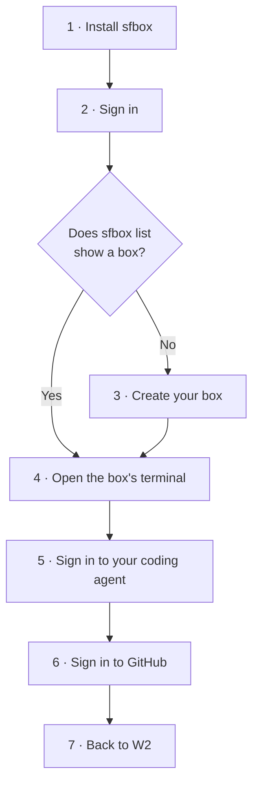

# Getting onto your cloud box

Your cloud box is a Linux machine in Google Cloud that already carries `gc`, `bd`, `dolt`, `gh` and three coding agents: Claude Code, Codex and Gemini CLI. You reach it with `sfbox` and the Google account or email address your instructor added to the cohort, so there are no key files, IP addresses or SSH settings to keep track of.

Running the two days on your own laptop instead? You don't need this page. Go straight to [W2's own-machine path](./progression/W2-cloud-box-and-preflight.md#your-own-machine-alternative).

## Contents

- [Before you start](#before-you-start)
- [Setup at a glance](#setup-at-a-glance)
- [Step 1: install sfbox](#step-1-install-sfbox)
- [Step 2: sign in](#step-2-sign-in)
- [Step 3: find or create your box](#step-3-find-or-create-your-box)
- [Step 4: open the box's terminal](#step-4-open-the-boxs-terminal)
- [Step 5: sign in to your coding agent](#step-5-sign-in-to-your-coding-agent)
- [Step 6: sign in to GitHub on the box](#step-6-sign-in-to-github-on-the-box)
- [Step 7: back to the tutorial](#step-7-back-to-the-tutorial)
- [Everyday commands](#everyday-commands)
- [Your boxes in a browser](#your-boxes-in-a-browser)
- [Troubleshooting](#troubleshooting)
- [Commands from the old box guide](#commands-from-the-old-box-guide)
- [Coming later](#coming-later)

## Before you start

- **A Mac or a Linux computer.** Windows works too, with its own install steps in the [sfbox README](https://github.com/actual-software/sfbox#windows).
- **The Google account or email address your instructor added.** Only addresses on the cohort's list can sign in. An address with no Google account behind it, such as a work address on Microsoft mail, can sign in with a code sent to it instead.
- **A browser on that same computer.** The sign-in hands back to `sfbox` on the computer that started it, so finishing it on your phone won't work.
- **Your own account for at least one coding agent:** a Claude subscription (Pro, Max, Team or Enterprise) for Claude Code, a ChatGPT account for Codex, or a Google account for Gemini CLI. Sign in with the account itself rather than an API key, because `gc init` checks each agent's sign-in and refuses API keys.

## Setup at a glance



Steps 1 to 4 run on your laptop and take a few minutes, most of it waiting for a new box. Steps 5 and 6 run in the box's terminal. The box has no browser, so each sign-in there gives you a link to open on your laptop and a code to carry between the two.

## Step 1: install sfbox

On your laptop:

**Copy and paste**

```bash
curl -fsSL https://github.com/actual-software/sfbox/releases/latest/download/install.sh | sh
```

The script picks the build for your computer, checks it against the release's checksums and puts `sfbox` in `~/.local/bin`. Already installed an earlier `sfbox`? Run the same line again, and it replaces it with the latest release.

**Expected output**

```text
==> Downloading sfbox v2.3.0 for darwin/arm64
==> Installed sfbox v2.3.0 at /Users/you/.local/bin/sfbox
==> Next, sign in: sfbox login
```

If `~/.local/bin` isn't on your `PATH` yet, it ends this way instead, with the line that adds it for your shell:

```text
==> /Users/you/.local/bin isn't on your PATH. Add it with this line, then open a new terminal:
    echo 'export PATH="$HOME/.local/bin:$PATH"' >> ~/.zshrc
==> Then sign in: sfbox login
```

Run that line, open a new terminal, and check that `sfbox` answers:

**Copy and paste**

```bash
sfbox version
```

## Step 2: sign in

**Copy and paste**

```bash
sfbox login
```

Your browser opens on the sign-in page. Choose **Sign in with Google** and pick the account your instructor added. If your address has no Google account and the page offers **Email me a code**, choose that: enter the address, then type in the six-digit code from the email, which works once, for 10 minutes. When the page says *You're signed in*, close the tab and go back to your terminal.

**Expected output**

```text
==> Opening your browser to sign in. If nothing opens, visit:
    https://control-plane-….run.app/login/cli?…
==> Signed in as you@example.com until Wed 19:42.
```

The last line says when your session ends. After that, any `sfbox` command tells you to sign in again, and `sfbox login` is all it takes.

## Step 3: find or create your box

Your instructor may have made your box already, so look first:

**Copy and paste**

```bash
sfbox list
```

**Expected output** when there's a box for you

```text
NAME     STATE  VM       COHORT       EXPIRY
ada-sfi  ready  RUNNING  sfi-2026-10  2026-11-14
```

If your box is there, skip to [step 4](#step-4-open-the-boxs-terminal) with its name. A `STATE` of `provisioning` means it's still being made, so wait a minute and run `sfbox list` again until it reads `ready`.

If the list says `You have no boxes`, create one. Pick a name: 3 to 26 lowercase letters, digits and single hyphens, starting with a letter and ending with a letter or digit. Everyone's boxes share one list of names, so make yours personal, such as your first name followed by `-sfi`.

**Copy and paste**, with your name in place of `ada-sfi`

```bash
sfbox create ada-sfi
```

**Expected output** (trimmed)

```text
==> Creating box ada-sfi. Setting up its accounts, disk and VM takes a minute or two.
==>   service accounts
==>   data disk
==>   vm
...
==>   [4/4] Writing /etc/gas-city.env
==> Box ada-sfi is ready. Open its terminal with: sfbox ssh ada-sfi
```

If the command is interrupted before the box is ready, run the same `sfbox create` again. It picks the box back up and keeps watching.

## Step 4: open the box's terminal

**Copy and paste**

```bash
sfbox ssh ada-sfi
```

You land in a shell on the box as the `ubuntu` user, in `/home/ubuntu`:

```text
ubuntu@box-ada-sfi:~$
```

A brand-new box takes a minute or two before it lets you in. `sfbox ssh` says so and keeps trying for a few minutes, so let it run:

```text
==> Box ada-sfi's access grants haven't reached Google yet, which takes a new box a minute or two. Trying again until 9:42AM.
```

In a new box's first minute, `sfbox ssh` can also stop with an error ending in `Run the same command again to resume.` Wait a minute, then run `sfbox ssh` again. The second try works.

Type `exit` to leave. The box keeps running, and everything under `/home/ubuntu` is still there the next time you connect.

## Step 5: sign in to your coding agent

Do this in the box's terminal, for the agent you'll use. You can sign in to more than one. The curriculum's examples use Claude Code, so if you use Codex or Gemini CLI, put `codex` or `gemini` where a page sets the provider to `claude`, and ask an instructor if you're not sure where.

The steps below were checked on the agent versions the box ships.

### Claude Code

1. Run `claude`.
2. Pick a text style and press Enter.
3. At **Select login method**, choose **1. Claude account with subscription**.
4. Copy the link under *Browser didn't open? Use the url below to sign in* and open it in your laptop's browser. It wraps over several lines, so copy all of them.
5. Sign in. The page then shows a code: copy it, paste it at **Paste code here if prompted**, and press Enter.
6. Answer the questions that follow, such as whether you trust this folder, then type `/exit`.

### Codex

1. Run `codex login --device-auth`.
2. Open https://auth.openai.com/codex/device in your laptop's browser and sign in with your ChatGPT account.
3. Enter the one-time code from the terminal. It expires after 15 minutes.

Use `--device-auth` on the box. Plain `codex login` hands its sign-in back to an address on the box itself, which your laptop's browser can't reach, and Codex says as much when you run it there.

### Gemini CLI

1. Run `gemini`.
2. When it asks whether you trust the files in this folder, choose **1. Trust folder (ubuntu)**. Gemini CLI restarts, which is expected.
3. At **How would you like to authenticate for this project?**, choose **1. Sign in with Google**.
4. Copy the link after *Please visit the following URL to authorize the application*, open it in your laptop's browser and sign in.
5. Copy the authorization code Google shows, paste it at **Enter the authorization code**, and press Enter.
6. Type `/quit` when you're done.

### Check the sign-in

Run the line for each agent you signed in to:

**Copy and paste**

```bash
claude -p 'Reply with exactly: FACTORY_OK'
codex login status
gemini -p 'Reply with exactly: FACTORY_OK'
```

Claude and Gemini each answer `FACTORY_OK`, the same check the box's own setup runs. Codex prints `Logged in using ChatGPT`.

## Step 6: sign in to GitHub on the box

Your factory pushes to GitHub from the box, so `gh` needs your account there as well.

**Copy and paste**

```bash
gh auth login
```

Press Enter at each question to take the defaults: **GitHub.com**, **HTTPS**, **Yes** to authenticating Git, and **Login with a web browser**. It then prints a one-time code. Open https://github.com/login/device in your laptop's browser, enter that code and approve the request. Along the way you'll see two warnings, one saying `gh` couldn't copy the code to a clipboard and one saying it couldn't open a browser, and both are expected on a box that has neither.

Rather not grant the CLI your whole account? Paste a token instead, as [W2's GitHub sign-in section](./progression/W2-cloud-box-and-preflight.md#5-sign-in-to-github) describes, since those steps work the same on the box.

Check it:

**Copy and paste**

```bash
gh auth status
```

It should name your GitHub account.

## Step 7: back to the tutorial

That's the box ready. Head back to [W2's box check](./progression/W2-cloud-box-and-preflight.md#2-check-the-box) and run it.

The box has no factory on it yet, and that's deliberate: it brings the toolchain and the agents, and [W3](./progression/W3-run-your-factory.md) is where you build the factory.

## Everyday commands

These run on your laptop and work only on your own boxes. `sfbox help` lists them all.

| Command | Purpose |
|---|---|
| `sfbox list` | Lists your boxes and whether each is running |
| `sfbox status <box>` | Shows one box's state, size, boot progress and health |
| `sfbox stop <box>` | Stops the box's VM. Your files stay, and a stopped box costs only its disks |
| `sfbox start <box>` | Starts it again. Give it about a minute to boot before `sfbox ssh` |
| `sfbox download <box> <folder>` | Copies a folder from the box to your laptop, leaving out sign-in files |
| `sfbox delete <box>` | Deletes the box, once you've typed its name to confirm |
| `sfbox ui` | Opens your boxes in a browser on your laptop, where you can also create a box, open its terminal and browse its files |
| `sfbox dashboard <box>` | Opens your factory's dashboard from the box in your laptop's browser, until you press Ctrl-C. Needs v2.4.0 or later |

- **`status`'s `Health` line looks only for a factory in `~/city`.** The one you build in W3 lives in `~/software-factory-intensive/factory1`, so that line keeps reading `service=inactive` and `city=no` while yours runs. Check yours from its own directory on the box with `gc session list`.
- **`download` reads a folder name without a leading `/` from your home on the box, `/home/ubuntu`.** `sfbox download ada-sfi software-factory-intensive/factory1` copies that folder into `./factory1` on your laptop. `--to <folder>` picks another local name, and an existing local folder is replaced only with `--force`. The copy leaves out every `.ssh` folder, each coding agent's sign-in file, `gh`'s token and `~/city/.env`. A `.env` in your W3 factory's folder is copied like any other file.
- **`delete` takes two or three minutes** and removes the box's VM, disk and accounts. A snapshot of its disk is kept for now, so an instructor can still recover files, but download anything you want to keep first.

## Your boxes in a browser

`sfbox ui` shows your boxes on a web page instead of in the terminal. It runs on your laptop and needs `sfbox` v2.3.0 or later for everything below, so update with the step 1 line if `sfbox version` shows an older one.

**Copy and paste**

```bash
sfbox ui
```

It opens your browser on a page that lists each box with its status and health, with a button for each of these:

- **New box** makes a box, with the same name rule as `sfbox create`, and shows it booting under **Activity**. If you already own as many boxes as a person may, the page says so.
- **Terminal** opens the box's shell in a new tab, the same one `sfbox ssh` opens. Closing the tab, or its **Close** button, ends it.
- **Files** lists the box's folders, starting at `/home/ubuntu`. Click a folder to open it, find files by name, search the text inside them, and download any folder shown. Sign-in files and `.ssh` folders are never listed, searched or downloaded.
- **Dashboard** opens the factory dashboard from that box in a new tab, the one `sfbox dashboard` opens, once a city is running there. It needs v2.4.0 or later, and it stays open until `sfbox ui` stops or you sign out.
- **Stop**, **Start**, **Download a folder** and **Delete** do what the `sfbox` commands of those names do. Delete asks you to type the box's name first.
- **Sign out** signs this computer out, which signs out `sfbox` in your terminal too.

About the page itself:

- **The page lives on your laptop.** Its address works only on this computer and only while `sfbox ui` runs, so leave that terminal open and press Ctrl-C there when you're done.
- **It uses your `sfbox login`.** If you aren't signed in, or your session runs out, it signs you in the same way.
- **A box you've just made can take a minute or two** before its terminal or files open, while Google catches up with its access. The page says it's waiting rather than failing.
- **Downloads land in your `Downloads` folder** by default, as `<box>-<folder>`. Type another folder in **Save to** to change that, and tick the box to replace one that already exists. The folder on the box is read from `/home/ubuntu`, as `sfbox download` reads it, and the same sign-in files are left out.

## Troubleshooting

- **`command not found: sfbox`.** The `PATH` line from step 1 hasn't reached this terminal. Run the line the installer printed, then open a new terminal.
- **The installer says another `sfbox` comes first on your `PATH`.** That's usually the older bash `sfbox` from this repo's `participant-box-cli/`. Delete the line that adds `participant-box-cli` to your `PATH` from `~/.zshrc` or `~/.bashrc`, then open a new terminal.
- **`you are not signed in`, or `your session expired`.** Run `sfbox login`.
- **The sign-in page refuses your Google account.** That account isn't on the cohort's list. Tell your instructor which account you used.
- **No code arrives by email.** Give it a minute and check your spam folder. Codes only go to addresses on the cohort's list, so if one still hasn't come, tell your instructor which address you typed. **Send a new code** works once a minute.
- **The page says the code is wrong or has expired.** Check the digits, or send a new code. A code works once, for 10 minutes, and allows five tries.
- **`no sign-in came back`.** The browser sign-in didn't finish in time, or it finished on another device. Run `sfbox login` again and finish it in a browser on this computer.
- **`the name "…" is taken; pick another`.** Someone else has a box with that name, so choose another.
- **`you already have … boxes, the most a person can own`.** Use a box you already have, which `sfbox list` shows, or delete one you're done with using `sfbox delete <box>` after downloading anything you want from it.
- **`no box named "…"`.** Check the spelling against `sfbox list`. Someone else's box gives the same answer, since you can only reach your own.
- **`box … is provisioning; wait until it is ready`.** The box is still being made. Run `sfbox create` with its name to watch it finish. If that says the box is busy, the create making it is still running, so wait a minute and run it again.
- **`Box …'s access grants haven't reached Google yet`.** Normal for a new box. Let `sfbox ssh` keep trying.
- **`sfbox ssh` fails in a new box's first minute, ending `Run the same command again to resume.`** Wait a minute, then run `sfbox ssh` again.
- **`box … is TERMINATED, so nothing on it can answer`.** Your box is stopped. Run `sfbox start <box>`, give it a minute to boot, then run `sfbox ssh` again.
- **`… already exists; pass --force to replace it, or name another folder with --to`.** `sfbox download` found a folder where it would put the copy. Name another with `--to`, or pass `--force` to replace it.
- **The terminal freezes after your laptop sleeps or changes Wi-Fi.** Close it and run `sfbox ssh` again. Your files on the box are where you left them.
- **An agent rejects its code.** Codes are single-use and expire. Start that agent's sign-in again for a fresh one.
- **`IAP reached box … but nothing answered on port 22`.** The box was started moments ago and is still booting. Give it a minute, then try again.
- **`gc's supervisor isn't running on box …, so there's no dashboard to open`.** `sfbox dashboard` found no running city on the box. Start yours with `gc start` in its folder on the box, then run `sfbox dashboard` again.
- **The `sfbox ui` page says to open the address `sfbox ui` printed.** That address belongs to an `sfbox ui` that has stopped, or the page was opened some other way. Run `sfbox ui` again, or open the address it printed in your terminal.

## Commands from the old box guide

Anything written for the previous `sfbox`, a bash script in this repo, uses its commands, which v2 doesn't have. Here's what to run in their place:

| Earlier pages say | Run instead |
|---|---|
| `sfbox box list` | `sfbox list` |
| `sfbox save-credential`, `sfbox box use`, `sfbox box current` | Nothing to save or select. Sign in once with `sfbox login`, then name your box in each command |
| `sfbox start-session` | `sfbox ssh <box>` |
| `sfbox get-box` | `sfbox status <box>` |
| `sfbox preflight` | `sfbox status <box>`, whose `Boot` line reads `ready` once the box is. On the box, `gas-city-boot-status` prints nothing once it's ready, and `systemctl is-active gas-city.service` checks the image's own factory service |
| `sfbox exec <command>` | `sfbox ssh <box>`, then run the command there |
| `sfbox gc <args>` | `sfbox ssh <box>`, then `gc <args>` from your city's directory |
| `sfbox dashboard` | `sfbox dashboard <box>`, from v2.4.0 |

## Coming later

These parts of `sfbox` are designed and not released yet. Until they are, the steps above and your instructor cover them:

- `sfbox setup`, which sets up and starts a factory on the box for you. During the intensive you build yours by hand in W3, so you won't miss it.
- `sfbox secrets set`, for values such as a Slack app's two tokens.
- Signing in to `sfbox` with a GitHub account instead of Google.
- `sfbox code`, `exec` and `gc`, among the rest.
