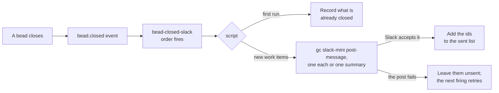

# slack-notify

An optional Day 2 pack. Each time the factory closes a piece of work on your rig, a message lands in a Slack channel, with the pull request link when the work went through the PR path. The lab that walks through it is [Slack notifications and the mayor](../../../hardening/08-slack-notifications.md).

The pack doesn't connect to Slack itself. Its posts go through `gc slack-mini post-message`, the one outbound verb of [slack-mini](https://github.com/gastownhall/gascity-packs/tree/520e95cb22992a8a1017f7a60da267f203497c7e/slack-mini), which the lab imports at city scope from gascity-packs. slack-mini's adapter holds the bot token and does the posting, so this pack is one order and one script, and it holds no secret. Nothing in it runs a model.

## Example posts

One closed bead with a PR:

```text
✅ Closed on ascii-art: `aa-0fd` Implement d.md · PR #3
```

`PR #3` is a link to the pull request. More than five closes in one firing arrive as a single summary instead, listing up to twenty of them:

```text
✅ ascii-art closed 6 beads:
• `aa-6ao` Implement e.md
• `aa-pps` Implement f.md · PR #4
• ...
```

## Relation to base-factory

`bead-closed-slack` is [base-factory](../base-factory/README.md)'s `bead-closed-log` with a channel in place of a file: same `event` trigger on `bead.closed`, same exec that asks `bd` what is closed and skips what it has already handled. Read the two order files side by side.

The difference is in what the script owes once the output reaches people. A duplicate log line costs nothing, and a duplicate post is noise in a channel your team reads. So `assets/scripts/bead_closed_slack.sh` adds three things on top of the log script:

| | Behaviour | Reason |
|---|---|---|
| Filter | Posts tasks, bugs, features, chores and epics, and skips any bead a formula created | A sling through `mol-polecat-pr` closes a step bead at each stage. Without the filter, one sling would post a dozen times. |
| Baseline | The first run records every bead already closed and posts none of them | Installing on a factory that has run all day would otherwise replay its history into the channel. |
| Burst cap | More than five new closes in one firing become one summary message | A burst of closes costs one post. |



## Adding it to your base factory

slack-mini has to be running first. The lab's steps 2 to 5 create the Slack app, hand its tokens to the supervisor, import slack-mini, and save your channel's ID to the city's `.env` as `SLACK_NOTIFY_CHANNEL`. Then the pack goes on the rig, and one firing by hand records the baseline:

```bash
cd "$SFI_PATH/factory1"
gc import add --rig ascii-art "$SFI_PATH/sf-tutorial/artifacts/packs/slack-notify"
gc reload
gc order run bead-closed-slack
```

Rig scope, like base-factory's orders, so it posts the rig's work and none of the city's own housekeeping. Import it on a second rig and that rig gets its own sent list; from then on, name the rig when you fire it by hand, as in `gc order run bead-closed-slack --rig ascii-art`.

## Settings

| Location | Setting | Default | Effect |
|---|---|---|---|
| `$SFI_PATH/factory1/.env` | `SLACK_NOTIFY_CHANNEL` | unset | The ID of the channel to post in, like `C0123ABCD`. Unset means installed but switched off: the order fires and the script exits without doing anything. |
| the environment | `GC_API_BASE_URL` | the port in the supervisor's `supervisor.toml`, else `8372` | Where `post-message` reaches the supervisor's API, as `http://127.0.0.1:<port>`. |
| `assets/scripts/bead_closed_slack.sh` | `BURST_MAX` | `5` | More new closes than this in one firing post as one summary. |
| `assets/scripts/bead_closed_slack.sh` | `SUMMARY_LINES` | `20` | Beads a summary lists before it says how many more there are. |
| `assets/scripts/bead_closed_slack.sh` | `WORK_TYPES` | task, bug, feature, chore, epic | The bead types that post. |

The script reads `.env` itself because an exec order never loads it. The [self-improvement pack](../self-improvement/README.md) does the same for its switch.

The last three live in the script. Here's the catch: an import from inside a git repository is pinned to the commit it was added at, so editing `sf-tutorial` in place won't change what the order runs. To tune them, copy the pack somewhere outside git, edit the copy, and import that path instead, since an import from outside git reads the files as they are.

## State

The sent list lives at `.gc/runtime/packs/slack-notify/<rig>/sent` under the city. It's plain text, one bead id per line, holding everything already posted plus everything that was already closed at install. Because it sits under `.gc/`, it never gets near the rig's git history. Want a fresh baseline? Delete the file, and the next firing records what's closed and posts none of it.

A failed post leaves its beads off the list, so the next firing tries them again. When the controller's firing fails, `gc events --type order.failed` shows the script's message, with the reason slack-mini gave, such as `slack: not_in_channel`.

## Turning it off

Either take the channel out or take the pack out:

```bash
cd "$SFI_PATH/factory1"
grep -v '^SLACK_NOTIFY_CHANNEL=' .env > .env.new; mv .env.new .env   # keep the pack, stop posting
gc import remove --rig ascii-art slack-notify && gc reload           # take the pack back out
```

With the channel gone, beads keep closing and nothing is recorded. Put the channel back and the next firing posts what closed in the meantime, as one summary when there are more than five. Neither line touches slack-mini, so the mayor keeps answering mentions.
