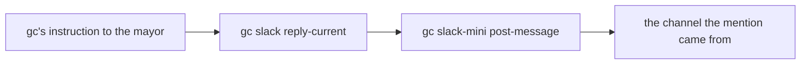

# slack-reply

This pack lets the mayor answer a Slack mention in the channel the mention came from. It's the smaller of the two packs this repo adds for the [Slack lab](../../../hardening/08-slack-notifications.md), an optional Day 2 exercise.

## The gap it fills

The lab imports [slack-mini](https://github.com/gastownhall/gascity-packs/tree/520e95cb22992a8a1017f7a60da267f203497c7e/slack-mini) from gascity-packs. Mention its bot in Slack and gc hands the message to the mayor, with an instruction attached:

```text
To reply in Slack, write your response to a file and run:
  gc slack reply-current --conversation-id C0123ABCD --body-file <path>
```

slack-mini's only outbound verb is `gc slack-mini post-message`, and it ships no `reply-current`. This pack ships that one command, under the name the instruction uses, and has it post the reply with post-message:



## Adding it

City scope, bound as `slack`:

```bash
cd "$SFI_PATH/factory1"
gc import add --name slack "$SFI_PATH/sf-tutorial/artifacts/packs/slack-reply"
gc reload
gc --help | grep -E '^ +slack '
```

The last line should print `slack           Commands from the slack import`. Both halves of the import line matter. gc only exposes a pack's commands from a city-scope import, and only under that import's name, so a rig-scope import or the default name would leave the mayor an instruction naming a command that doesn't exist.

## Usage

```text
gc slack reply-current --conversation-id <channel-id>
                       (--body-file <path> | --body <text>)
                       [--reply-to <ts>]
```

`--conversation-id` is the Slack channel ID, which gc's instruction always passes. A reply goes to the channel; `--reply-to` (or `--thread-ts`) threads it under a given message instead. On success the command prints Slack's answer, `{"ok":true,...}`, and on failure it prints slack-mini's error, such as `slack: not_in_channel`, and exits non-zero. `gc slack reply-current --help` has the details.

The command holds no token. It reaches slack-mini's adapter through the supervisor's API, and the adapter posts with the bot token it keeps. `GC_API_BASE_URL` says where that API listens. When it's unset, the command reads the port from the supervisor's `supervisor.toml` and falls back to `8372`, the supervisor's default, so a mayor session started before you set the variable still gets through.

## Threads

A reply lands in the channel rather than under the message that prompted it. gc's instruction names the channel a mention came from but not the message's timestamp, so the mayor has nothing to pass `--reply-to`. slack-channel, the next Slack tier up, remembers the message and can thread its replies under it.

## Turning it off

```bash
cd "$SFI_PATH/factory1"
gc import remove slack && gc reload
```

The mayor still receives mentions after that, and its replies fail with `unknown command "slack"` until you put the pack back.
