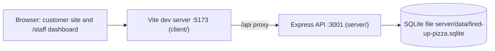

# Current architecture

This page maps the codebase as it exists today and names the bead that built each piece. Binding rules live in [`docs/decision-records/`](../decision-records/). Product requirements live in [`docs/PROJECT_MANIFEST.md`](../PROJECT_MANIFEST.md). Progress is tracked in the bead ledger (`gc bd list --parent <epic-id>`), not here.

**State:** MVP complete. Every module below is implemented and tested. `fup-e6u.2` checked a clean checkout: `npm install && npm run dev` creates, migrates, and seeds the database, and every quality gate passes.

## System overview

- `npm run dev` starts both processes. There are no other services, as required by the manifest Constraints.
- At startup the API applies pending migrations and seeds an empty catalog before it listens (ADR 0002 rules 3 and 4).
- Live views refresh by polling (ADR 0007). Nothing is pushed from the server.
- `shared/` is a TypeScript-only package that both sides import for domain types and pure rules.

## Module map

State key:

- **Done**: implemented and tested.
- **Stub**: the file exists and is wired in, but its bead implements it.
- **Planned**: its bead creates the file.

### shared/

| Path                       | Responsibility                                                             | State | Owner                          |
| -------------------------- | -------------------------------------------------------------------------- | ----- | ------------------------------ |
| `src/index.ts`             | Package root: re-exports `domain` and `api-error`                          | Done  | `fup-be5`                      |
| `src/domain.ts`            | Domain entity types, `ORDER_STATUSES`, `isOrderStatus`                     | Done  | `fup-be5`                      |
| `src/api-error.ts`         | Error codes, response shape, `isApiErrorBody`, `apiErrorIssues` (ADR 0006) | Done  | `fup-be5`; issues: `fup-oe9.6` |
| `src/pricing.ts`           | Pricing formula and ordering limits (ADR 0003)                             | Done  | `fup-qt5.2`                    |
| `src/order-status.ts`      | Transition table, live statuses, and action labels (ADR 0004)              | Done  | `fup-qt5.3`                    |
| `src/phone.ts`             | Phone normalize/format (ADR 0005)                                          | Done  | `fup-qt5.4`                    |
| `src/orders-api.ts`        | `PlaceOrderRequest`, `OrderDetails`, order limits                          | Done  | `fup-oe9.5`                    |
| `src/staff-orders-api.ts`  | Staff queue query and status-update request types                          | Done  | `fup-b3a.1`                    |
| `src/staff-catalog-api.ts` | Staff create/update request types and field limits                         | Done  | `fup-y7n.1`                    |

### server/

| Path                                                        | Responsibility                                          | State | Owner                    |
| ----------------------------------------------------------- | ------------------------------------------------------- | ----- | ------------------------ |
| `src/index.ts`                                              | Process entry: config, database, migrate, seed, listen  | Done  | `fup-be5`, `fup-qt5.1`   |
| `src/app.ts`, `src/app-dependencies.ts`                     | `createApp({ db })`: JSON parsing, routers, 404, errors | Done  | `fup-be5`                |
| `src/config.ts`                                             | `PORT`, `DATABASE_PATH`                                 | Done  | `fup-be5`                |
| `src/db/connection.ts`                                      | `openDatabase()` with foreign keys and WAL; health ping | Done  | `fup-be5`                |
| `src/db/migrate.ts`, `src/db/migrations/`, `src/db/seed.ts` | Migration runner, schema, catalog seed (ADR 0002)       | Done  | `fup-qt5.1`              |
| `src/test/database.ts`                                      | `createTestDatabase({ seed })` for tests                | Done  | `fup-qt5.1`              |
| `src/http/errors.ts`                                        | `AppError`, code→status map, error and 404 handlers     | Done  | `fup-be5`                |
| `src/http/validate.ts`                                      | `parseWith(schema, input)` (zod)                        | Done  | `fup-be5`                |
| `src/repositories/catalog.ts`                               | Catalog reads; staff writes                             | Done  | `fup-qt5.1`, `fup-y7n.1` |
| `src/repositories/order-status.ts`                          | All `orders.status` SQL                                 | Done  | `fup-qt5.3`              |
| `src/repositories/orders.ts`                                | Order insert and read model                             | Done  | `fup-oe9.5`              |
| `src/services/pricing.ts`                                   | `priceOrderItems` (server-side prices)                  | Done  | `fup-qt5.2`              |
| `src/services/order-status.ts`                              | The only writer of order status                         | Done  | `fup-qt5.3`              |
| `src/services/orders.ts`                                    | Place-order use case                                    | Done  | `fup-oe9.5`              |
| `src/identity/index.ts`                                     | `resolveCustomerIdentity`, phone zod schema             | Done  | `fup-qt5.4`              |
| `src/routes/health.ts`                                      | `GET /api/health`                                       | Done  | `fup-be5`                |
| `src/routes/catalog.ts`                                     | Customer catalog `GET`s                                 | Done  | `fup-oe9.1`              |
| `src/routes/orders.ts`                                      | `POST /api/orders`; `GET /api/orders?phone=`            | Done  | `fup-oe9.5`, `fup-bq3.1` |
| `src/routes/staff/index.ts`, `require-staff.ts`             | Staff mount point and access-control hook               | Done  | `fup-be5`                |
| `src/routes/staff/orders.ts`                                | Staff queue and status transitions                      | Done  | `fup-b3a.1`              |
| `src/routes/staff/catalog.ts`                               | Menu item and topping management                        | Done  | `fup-y7n.1`              |
| `src/mvp-flows.test.ts`                                     | End-to-end API flows per success criterion              | Done  | `fup-e6u.1`              |

### client/

| Path                                                                                 | Responsibility                                      | State | Owner                                 |
| ------------------------------------------------------------------------------------ | --------------------------------------------------- | ----- | ------------------------------------- |
| `src/main.tsx`, `src/App.tsx`, `src/router-future-flags.ts`                          | Entry point, complete route table, router flags     | Done  | `fup-be5`                             |
| `src/index.css`                                                                      | The only stylesheet: the Tailwind entry (ADR 0007)  | Done  | `fup-be5`                             |
| `src/AppProviders.tsx`                                                               | All context providers                               | Done  | `fup-be5`; cart provider: `fup-oe9.3` |
| `src/components/Layout.tsx`, `src/components/StaffLayout.tsx`                        | Customer and staff shells, with `nav-link-class.ts` | Done  | `fup-be5`; cart count: `fup-oe9.3`    |
| `src/pages/NotFoundPage.tsx`                                                         | Page for unknown paths                              | Done  | `fup-be5`                             |
| `src/test/setup.ts`, `src/test/render.tsx`                                           | jest-dom setup, `renderWithProviders`, `renderApp`  | Done  | `fup-be5`                             |
| `src/api/http.ts`, `src/hooks/`, view-state components, `src/lib/`                   | HTTP client, `useAsync`, `usePolling`, formatting   | Done  | `fup-qt5.5`                           |
| `src/pages/customer/MenuPage.tsx`, `src/api/catalog.ts`                              | Menu, with `src/components/MenuItemCard.tsx`        | Done  | `fup-oe9.2`                           |
| `src/context/CartContext.tsx`                                                        | Cart state with persistence                         | Done  | `fup-oe9.3`                           |
| `src/pages/customer/PizzaBuilderPage.tsx`                                            | Pizza builder, with `src/components/builder/`       | Done  | `fup-oe9.4`                           |
| `src/pages/customer/CartPage.tsx`, `OrderConfirmationPage.tsx`, `src/api/orders.ts`  | Cart, checkout, confirmation                        | Done  | `fup-oe9.6`                           |
| `src/pages/customer/OrderTrackingPage.tsx`, `src/components/OrderStatusProgress.tsx` | Order tracking with a status indicator              | Done  | `fup-bq3.2`                           |
| `src/pages/staff/StaffOrderQueuePage.tsx`, `src/api/staff-orders.ts`                 | Staff order queue, with `src/components/staff/`     | Done  | `fup-b3a.2`                           |
| `src/pages/staff/StaffMenuPage.tsx`, `src/api/staff-catalog.ts`                      | Menu management, with `src/components/staff/`       | Done  | `fup-y7n.2`                           |

The view-state components are `LoadingState`, `EmptyState`, `ErrorState`, and `StaleDataBanner` in `src/components/`. `src/lib/` holds money and time formatting.

## Request flows

- **Customer ordering:**
  1. The menu and builder read the catalog `GET` endpoints.
  2. The cart lives in React Context and localStorage, with estimates from `shared/src/pricing.ts`.
  3. Checkout sends `POST /api/orders`. The server resolves the phone through `identity/`, prices items through `services/pricing.ts`, then inserts the order, items, topping snapshots, and the initial status event in one transaction.
  4. The confirmation shows the server's totals.
- **Customer tracking:** `/track` polls `GET /api/orders?phone=…` every 10 seconds. The response holds that phone's orders only.
- **Staff queue:** `/staff/orders` polls `GET /api/staff/orders` every 10 seconds. Status buttons call `PATCH /api/staff/orders/:id/status`, which goes through `services/order-status.ts`: a conditional update plus an event row, with 409 on conflict.
- **Staff menu:** `/staff/menu` uses the `/api/staff/menu-items` and `/api/staff/toppings` endpoints. Hiding sets `available = false`.

## Work breakdown

Planned under `fup-be5`. Every task depended, directly or through earlier tasks, on `fup-be5`, and every task is now complete.

| Epic      | Scope                   | Tasks                                                                                                                        |
| --------- | ----------------------- | ---------------------------------------------------------------------------------------------------------------------------- |
| `fup-qt5` | Core domain & data      | `.1` persistence · `.2` pricing · `.3` order status · `.4` phone identity · `.5` client foundations                          |
| `fup-oe9` | Customer ordering       | `.1` catalog API · `.2` menu page · `.3` cart state · `.4` pizza builder · `.5` place-order API · `.6` cart & checkout pages |
| `fup-bq3` | Customer order tracking | `.1` lookup API · `.2` tracking page                                                                                         |
| `fup-b3a` | Staff order queue       | `.1` staff orders API · `.2` queue page                                                                                      |
| `fup-y7n` | Staff menu management   | `.1` staff catalog API · `.2` menu management page                                                                           |
| `fup-e6u` | MVP release readiness   | `.1` end-to-end API flow tests · `.2` clean-checkout verification and docs                                                   |

Dependency waves:

1. `fup-qt5.1`, `fup-qt5.4`, `fup-qt5.5`
2. `fup-qt5.2`, `fup-qt5.3`, `fup-oe9.1`, `fup-y7n.1`
3. `fup-oe9.2`, `fup-oe9.3`, `fup-oe9.5`, `fup-y7n.2`
4. `fup-oe9.4`, `fup-oe9.6`, `fup-bq3.1`, `fup-b3a.1`
5. `fup-bq3.2`, `fup-b3a.2`, `fup-e6u.1`
6. `fup-e6u.2`

## Differences from the manifest's proposed structure

- Decision records live in `docs/decision-records/`, not `docs/adr/`. That is where this rig's architect reads them (ADR 0000).
- The server adds `app.ts`, `config.ts`, `http/`, `identity/`, and `repositories/`, and the client adds `App.tsx`, `AppProviders.tsx`, `lib/`, and `test/`. ADR 0001 rules 5 and 6 set out this layout. Beyond those rules, the server has `app-dependencies.ts` (the `{ db }` that routers receive, ADR 0006 rule 7) and `test/` (the test database helper), and the client has `router-future-flags.ts`, which `main.tsx` and the test render helper share.
- `context/` holds only the cart. There is no staff session, because staff access control is not built yet; it will go in `requireStaff` (ADR 0006 rule 3).
- The six-agent pipeline folders (`work-packages/`, `design/`, `review-reports/`, `release-gates/`) are not created. This rig runs the Gas City polecat → refinery → architect flow: beads carry the plan, the architect's verdict is written onto each bead, and branches are named by the factory (`polecat/<bead-id>`). Create those folders if the six-agent pipeline is adopted.
