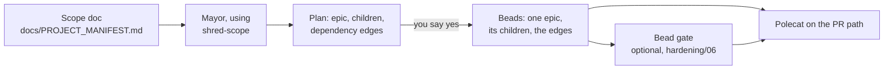

# Shred a Scope into Beads

## Contents

- [Objective](#objective)
- [Prereqs](#prereqs)
- [Context](#context)
  - [A skill in a pack](#a-skill-in-a-pack)
  - [The skill's four rules](#the-skills-four-rules)
- [Timing](#timing)
- [Try It](#try-it)
  - [1. Install the shred-scope pack](#1-install-the-shred-scope-pack)
  - [2. Check the mayor has the skill](#2-check-the-mayor-has-the-skill)
  - [3. Give it a scope](#3-give-it-a-scope)
  - [4. Ask the mayor to shred it](#4-ask-the-mayor-to-shred-it)
  - [5. Read what it wrote](#5-read-what-it-wrote)
  - [6. Send one child down the PR path](#6-send-one-child-down-the-pr-path)
  - [7. Reflect](#7-reflect)
- [Verification](#verification)
- [Ceiling](#ceiling)
- [Troubleshooting](#troubleshooting)
- [What's next](#whats-next)

## Objective

By the end of this exercise you'll have installed a pack that ships a skill instead of an agent, checked that the mayor can load it, had the mayor cut a scope into an epic and child beads with the dependencies between them written down, and sent one of those children to a polecat on the PR path.

## Prereqs

- [W3](../progression/W3-run-your-factory.md) complete: the base factory installed on a rig, and the mayor from `pr-gate-city` running at city scope.
- `$SFI_PATH` set in your shell, plus `$MY_RIG_PATH` if you're shredding your own manifest. [W2](../progression/W2-cloud-box-and-preflight.md) appends the first to a shell rc and [L1 step 1](../progression/L1-plan-your-factory.md#1-register-your-repo-as-a-rig) the second, so both survive a new terminal. Every other path on this page is written out from them.
- A scope to shred. The intended one is your own project manifest from [L1](../progression/L1-plan-your-factory.md), at `$MY_RIG_PATH/docs/PROJECT_MANIFEST.md`. Skipped L1? The pack ships a small sample for `ascii-art`, and step 3 installs it.
- `jq` installed, since the skill uses it to read bead ids back from `bd`.
- **A mayor running Claude Code, or Codex on the cloud box.** gc v1.4.0, the build W2 installs on a laptop, writes Codex's skills to `.codex/skills`, a directory Codex never reads, so a Codex mayor on a laptop won't ever see the skill. Upstream moved them to `.agents/skills` in [`4160b0ec8`](https://github.com/gastownhall/gascity/commit/4160b0ec833cd532ce987db4b52ad2073e767082), and the cloud box runs a build that has the change. So it's a lab for the cloud box, or for Claude on a laptop.

**This option needs no other option.** It adds one skill, and there's no agent, formula or order in it. It pairs well with the [bead gate](./06-bead-gate-checks.md), whose project-manager can check every bead the skill writes.

## Context

[L1](../progression/L1-plan-your-factory.md) left you with a manifest describing your project and three beads you wrote by hand, and W3 seeded `ascii-art` with a script. Neither one scales to a real backlog. Somebody has to read a scope, cut it into pieces a polecat can finish in one run, and say which piece needs which. That's called shredding, and this lab hands it to an agent.

### A skill in a pack

Every option so far has added agents, formulas or orders. This one's different: it adds a **skill**, a Markdown file whose `name` and `description` frontmatter tell a coding agent when to load it. Claude Code and Codex both read them.

There's nothing to configure when a pack ships one. Any `skills/<name>/SKILL.md` in an imported pack is discovered by convention ([`skill_discovery.go:19-22`](https://github.com/gastownhall/gascity/blob/6f770bf87f92df771ffa2aa9e7a8eb369d0b4df8/internal/config/skill_discovery.go#L19-L22)), named `<binding>.<name>` ([`skills.go:282-286`](https://github.com/gastownhall/gascity/blob/6f770bf87f92df771ffa2aa9e7a8eb369d0b4df8/internal/materialize/skills.go#L282-L286)), and linked into the skill directory of every agent the import reaches: `.claude/skills` for Claude, `.agents/skills` for Codex. This pack's binding is `shred-scope`, so its one skill arrives as `shred-scope.shred-scope`.

Which agents those are depends on the import's scope. A city-scope import reaches every agent in the city, the mayor included. A rig-scope import (`--rig`) reaches only that rig's agents ([`skill_catalog.go:10-20`](https://github.com/gastownhall/gascity/blob/6f770bf87f92df771ffa2aa9e7a8eb369d0b4df8/cmd/gc/skill_catalog.go#L10-L20)). Shredding's a conversation, so it belongs with the agent you talk to, which is the mayor, and that's why this pack goes in at **city** scope. You'll see the result in step 2.

### The skill's four rules



[The skill](../artifacts/packs/shred-scope/skills/shred-scope/SKILL.md) spells out each of them:

- **It proposes before it writes.** You see the epic, every child and every edge, and nothing reaches the bead store until you say yes. It never slings.
- **One child is one polecat run**: one target file and one check that says it's done. At most 12 children go under an epic, and a bigger scope is split into several epics first.
- **An edge means one child reads another's output.** An edge keeps the dependent out of `bd ready` until the other closes, so a preference about order doesn't get one.
- **Every child is written to pass the bead gate**: a meaningful title, a concrete deliverable, `metadata.target_file`, a parent epic, and a `Done when:` line a test could assert.

## Timing

Forty-five minutes, participant-led. Install and check take five minutes. Writing a scope takes about ten with your own manifest and none with the sample. The mayor needs a few minutes to read the scope and propose, and a few more to write the beads, which leaves time to read them and sling one.

## Try It

### 1. Install the shred-scope pack

Read the pack first. The skill is the file that matters.

**Copy and paste**

```bash
cd "$SFI_PATH/factory1"
cat "$SFI_PATH/sf-tutorial/artifacts/packs/shred-scope/pack.toml"
cat "$SFI_PATH/sf-tutorial/artifacts/packs/shred-scope/skills/shred-scope/SKILL.md"
```

`pack.toml` declares nothing but the pack's name. There's no key for the skill, because gc finds it by its path.

Import the pack at city scope, with no `--rig`, and reload:

**Copy and paste**

```bash
cd "$SFI_PATH/factory1"
gc import add "$SFI_PATH/sf-tutorial/artifacts/packs/shred-scope"
gc reload
gc import list
```

**Expected output**

```text
Added import "shred-scope" from file://$SFI_PATH/sf-tutorial//artifacts/packs/shred-scope
Config reloaded: <n> agents, <n> rigs (rev <hash>)
...
shred-scope	file://$SFI_PATH/sf-tutorial//artifacts/packs/shred-scope	sha:<commit>	sha:<commit>
```

**What to notice.** The source is a `file://` URL with a `sha:` beside it. Because the pack sits inside your `sf-tutorial` clone, which is a git repository, gc locked the import to the clone's current commit ([`cmd_import.go:154-156`](https://github.com/gastownhall/gascity/blob/6f770bf87f92df771ffa2aa9e7a8eb369d0b4df8/cmd/gc/cmd_import.go#L154-L156)). Agents read the skill from that commit, not from your working tree, which matters as soon as you want to change it ([Troubleshooting](#an-edit-to-skillmd-changes-nothing)).

### 2. Check the mayor has the skill

**Copy and paste**

```bash
cd "$SFI_PATH/factory1"
gc skill list --agent mayor
```

**Expected output**

```text
NAME                     FROM         PATH
core.gc-agents           core         ~/.gc/cache/repos/<hash>/internal/bootstrap/packs/core/skills/gc-agents/SKILL.md
...
shred-scope.shred-scope  shred-scope  ~/.gc/cache/repos/<hash>/artifacts/packs/shred-scope/skills/shred-scope/SKILL.md
```

The last row is the one you just added. Its path is in gc's cache of the commit it locked, and `ls .claude/skills` in the city directory shows the link gc made for a Claude mayor (`.agents/skills` for Codex). A mayor that was already running picks the skill up without a restart.

### 3. Give it a scope

The skill shreds the part of a document that says what to build. Use your own manifest or the sample.

**Your own manifest.** A manifest from the manifest generator describes your project well, but it rarely lists the next piece of work. Its nearest section is Per-Feature Success, under Success Criteria, and the skill will use that. You get a better cut by adding a short `## Scope` section at the end: what you want built next in three to eight bullets, naming files where you know them, and one line on what's out of scope.

**Copy and paste**

```bash
nano "$MY_RIG_PATH/docs/PROJECT_MANIFEST.md"
```

**The sample.** For `ascii-art`, the pack ships [a filled-in manifest](../artifacts/packs/shred-scope/examples/PROJECT_MANIFEST.md) whose scope is the numbers 1 to 5 plus a gallery page that copies them. Put it where a manifest lives in the rig:

**Copy and paste**

```bash
cp "$SFI_PATH/sf-tutorial/artifacts/packs/shred-scope/examples/PROJECT_MANIFEST.md" \
   "$SFI_PATH/ascii-art/docs/PROJECT_MANIFEST.md"
```

The rest of this page shows the sample's output. Your own scope produces different beads through the same steps.

### 4. Ask the mayor to shred it

**Copy and paste**

```bash
cd "$SFI_PATH/factory1"
gc session attach mayor
```

Ask it, naming your scope doc and your rig:

> Use the shred-scope skill on docs/PROJECT_MANIFEST.md in the ascii-art rig.

The mayor reads the manifest and the documents it points at, then shows a plan and stops. An excerpt from the sample:

```text
Epic: ASCII numbers 1 to 5 and their gallery

| # | Title                            | target_file            | Done when                                  | Needs         |
|---|----------------------------------|------------------------|--------------------------------------------|---------------|
| 1 | Implement ascii/1.md             | ascii/1.md             | The four checks below pass for 1           | —             |
...
| 6 | Implement gallery/numbers-1-5.md | gallery/numbers-1-5.md | The H2s are ## 1 to ## 5 in order, and ... | 1, 2, 3, 4, 5 |

Create these beads? (yes / change something / no)
```

Read the plan before you answer, because this is the cheapest moment to fix a bad cut. Could one polecat finish each child? Does every edge mean "reads the other's output"? Does each `Done when:` line name something you could check? If not, say what to change and it redraws the plan. When it's right, answer:

> yes

It creates the epic, then the children, then the edges, and finishes with a report naming every id. Detach with `Ctrl-b` then `d`.

**What to notice.** The plan ends with what the mayor assumed or left out. That list is where a scope's gaps show up: a rule two documents state differently, a check the scope implies but never wrote down, a phrase the mayor had to read one way. Each one is a sentence worth adding to the scope before the next shred.

### 5. Read what it wrote

The beads live in the rig's store, so read them from the rig directory, using the epic id from the mayor's report. On your own rig, that's `cd "$MY_RIG_PATH"`, here and wherever a later step runs `cd "$SFI_PATH/ascii-art"`.

**Copy and paste**

```bash
cd "$SFI_PATH/ascii-art"
bd list --type=epic
export EPIC=<the epic id from the mayor's report>
bd list --parent "$EPIC"
```

**Expected output**

```text
○ aa-vx0 P2 [epic] ASCII numbers 1 to 5 and their gallery
├── ○ aa-vx0.1 P2 Implement ascii/1.md
├── ○ aa-vx0.2 P2 Implement ascii/2.md
├── ○ aa-vx0.3 P2 Implement ascii/3.md
├── ○ aa-vx0.4 P2 Implement ascii/4.md
├── ○ aa-vx0.5 P2 Implement ascii/5.md
└── ○ aa-vx0.6 P2 Implement gallery/numbers-1-5.md
```

Every child names the file it writes:

**Copy and paste**

```bash
bd list --parent "$EPIC" --json | jq -r '.[] | "\(.id)  \(.metadata.target_file // "MISSING")  \(.title)"'
```

The gallery is the sample's last child, and it waits on the five numbers. Read its edges, then see what's ready. On your own scope, read the edges of any child the plan said needs another.

**Copy and paste**

```bash
bd dep list "$EPIC.6"
bd ready --parent "$EPIC"
```

**Expected output**

```text
  aa-vx0: ASCII numbers 1 to 5 and their gallery [P2] (open) via parent-child
  aa-vx0.1: Implement ascii/1.md [P2] (open) via blocks
  aa-vx0.2: Implement ascii/2.md [P2] (open) via blocks
  aa-vx0.3: Implement ascii/3.md [P2] (open) via blocks
  aa-vx0.4: Implement ascii/4.md [P2] (open) via blocks
  aa-vx0.5: Implement ascii/5.md [P2] (open) via blocks

○ aa-vx0.1 P2 Implement ascii/1.md ← ASCII numbers 1 to 5 and their gallery
...
○ aa-vx0.5 P2 Implement ascii/5.md ← ASCII numbers 1 to 5 and their gallery
Ready: 5 issues with no active blockers
```

The ready list has the five numbers and leaves the gallery out.

**What to notice.** The edges are already doing work. No polecat can claim the gallery until all five numbers close, and nobody had to remember the order.

### 6. Send one child down the PR path

Pick a ready child (for the sample, any number will do) and sling it to the base factory's polecat with the PR formula:

**Copy and paste**

```bash
cd "$SFI_PATH/factory1"
gc sling ascii-art/base-factory.polecat <a-ready-child-id> --on mol-polecat-pr
```

On your own rig, the target's `<your-rig-name>/base-factory.polecat`. Don't be thrown by the id `gc sling` prints back: it belongs to the workflow it started, the bead titled `mol-polecat-pr`, so keep using the child's id. Then watch the child from the rig until the pull request shows up:

**Copy and paste**

```bash
cd "$SFI_PATH/ascii-art"
bd show <a-ready-child-id> --json | jq '.[0] | {status, metadata}'
gh pr list
```

Installed the [bead gate](./06-bead-gate-checks.md)? Then you can send the child through its project-manager first, using the command from that page. The beads this skill writes should pass it as they stand.

### 7. Reflect

A paragraph of scope became beads the factory can act on, and the order between them is stored as data instead of in somebody's head. Two things are worth keeping.

**The cut is still yours.** The skill proposes, and step 4's review is where the judgment lives. A careless shred makes careless beads, only faster.

**A skill changes what an agent can do without adding an agent.** Nothing new runs in your factory or takes a pool slot, and removing the import takes the ability away again. When the work's a conversation with an agent you've already got, a skill is often the smaller change.

## Verification

**Copy and paste**

```bash
cd "$SFI_PATH/factory1"
gc skill list --agent mayor | grep 'shred-scope.shred-scope'

cd "$SFI_PATH/ascii-art"
bd list --parent "$EPIC" --json | jq 'length'
bd list --parent "$EPIC" --json | jq -r '.[] | select((.metadata.target_file // "") == "") | .id'
```

Expect one skill row, a child count of at least 3, and nothing from the last command, which prints any child missing its `target_file`. `bd dep list` on a child that needs another shows its edges as `blocks`.

## Ceiling

Tailor the skill to your project. Copy the pack out of the `sf-tutorial` clone, import the copy instead (see [the edit trap](#an-edit-to-skillmd-changes-nothing)), and add what your gate cares about to its `SKILL.md`: your real test command for every `Done when:` line, a size limit, the reviewer each kind of child needs. Then shred a second scope and compare the plans.

## Troubleshooting

### `gc skill list --agent mayor` shows no shred-scope row

The pack was probably imported at rig scope, which reaches only that rig's agents. `gc import list --rig <rig-name>` would list it. Remove it there with `gc import remove --rig <rig-name> shred-scope`, then run step 1's `gc import add` with no `--rig`, and `gc reload`.

### The mayor says it has no shred-scope skill

Look for the link in the city directory: `ls "$SFI_PATH/factory1/.claude/skills"` for Claude, or `ls "$SFI_PATH/factory1/.agents/skills"` for Codex. A Codex mayor on a laptop running gc v1.4.0 gets no pack skills at all, because that build writes them to `.codex/skills`, which Codex never reads. Use the cloud box, or Claude.

### An edit to SKILL.md changes nothing

The import is locked to the commit your clone was at when you ran `gc import add`, and agents read that commit. A new commit doesn't move the lock, and neither does `git pull`. `gc import upgrade shred-scope` reports the old commit and leaves it there too. To pick up a committed change, remove the import and add it again:

**Copy and paste**

```bash
cd "$SFI_PATH/factory1"
gc import remove shred-scope
gc import add "$SFI_PATH/sf-tutorial/artifacts/packs/shred-scope"
gc reload
```

While you're iterating on the skill, a copy outside git is easier. gc stores it as a plain path with no lock, so an edit reaches the mayor without any commit:

**Copy and paste**

```bash
mkdir -p "$SFI_PATH/my-packs"
cp -R "$SFI_PATH/sf-tutorial/artifacts/packs/shred-scope" "$SFI_PATH/my-packs/shred-scope"
git -C "$SFI_PATH/my-packs/shred-scope" rev-parse --is-inside-work-tree 2>/dev/null || echo "outside git"
cd "$SFI_PATH/factory1"
gc import remove shred-scope
gc import add "$SFI_PATH/my-packs/shred-scope"
gc reload
```

The third line should print `outside git`; if it prints `true`, pick a directory outside every repository. `gc import list` then shows the copy as a `(path)` with no `sha:`, and `gc skill list --agent mayor` shows a path under `my-packs`.

### The epic's id carries the city's prefix

The beads went to the city's own store, where the rig's polecat never looks. `gc rig list` shows each prefix. The skill runs every `bd` command through `gc bd --rig <rig>`, so name the rig in your request and shred again, then close the stray beads with `bd close` from the city directory.

### A big scope comes back as several epics

That's the 12-children rule working. Say yes to one epic, work it, and shred the next when you're ready for it.

## What's next

This is one of the Day 2 options, and like the others it installs on the base factory alone. The list is in [the feature labs](../progression/L3-L5-feature-labs.md).

[L1](../progression/L1-plan-your-factory.md) is where the manifest came from, and the [bead gate](./06-bead-gate-checks.md) checks every bead this skill writes before a polecat may claim it.

« [back to the feature labs](../progression/L3-L5-feature-labs.md) »
