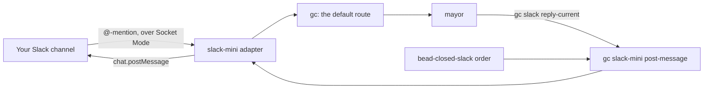

# Slack Notifications and the Mayor

## Contents

- [Objective](#objective)
- [Prereqs](#prereqs)
- [Context](#context)
  - [Four pieces](#four-pieces)
  - [The notification order](#the-notification-order)
  - [The tokens](#the-tokens)
- [Lab timing](#lab-timing)
- [Try It](#try-it)
  - [1. Pick a workspace and make a channel](#1-pick-a-workspace-and-make-a-channel)
  - [2. Create the app from slack-mini's manifest](#2-create-the-app-from-slack-minis-manifest)
  - [3. Collect the two tokens](#3-collect-the-two-tokens)
  - [4. Hand the tokens to the supervisor](#4-hand-the-tokens-to-the-supervisor)
  - [5. Import slack-mini and send a first post](#5-import-slack-mini-and-send-a-first-post)
  - [6. Route Slack conversations to the mayor](#6-route-slack-conversations-to-the-mayor)
  - [7. Talk to the mayor](#7-talk-to-the-mayor)
  - [8. Install the notification order](#8-install-the-notification-order)
  - [9. Sling a bead and watch the post arrive](#9-sling-a-bead-and-watch-the-post-arrive)
  - [10. Reflect](#10-reflect)
- [Verification](#verification)
- [Troubleshooting](#troubleshooting)
- [Going further](#going-further)
- [What's next](#whats-next)

## Objective

By the end of this lab your factory lives in a Slack channel as well as in your terminal. You @-mention a bot there and the mayor answers in the channel, and each time the factory closes a piece of work a post lands there with the pull request link.

The Slack connection is `slack-mini`, the smallest of the Slack packs in [gascity-packs](https://github.com/gastownhall/gascity-packs), imported at a pinned commit. Two short packs from this repo connect it to the factory you built in W3.

## Prereqs

- [W3](../progression/W3-run-your-factory.md) complete: the base factory installed on the `ascii-art` rig, which publishes its work as pull requests to your GitHub repository, and the mayor from `pr-gate-city` running at city scope.
- `$SFI_PATH` set in your shell. [W2](../progression/W2-cloud-box-and-preflight.md) appends it to a shell rc, so it survives a new terminal.
- A copy of this repo recent enough to hold the packs. `ls "$SFI_PATH/sf-tutorial/artifacts/packs/slack-reply"` should list `pack.toml`; if the folder is missing, run `git -C "$SFI_PATH/sf-tutorial" pull`. Packs you've already imported stay pinned to the commit they came from.
- A Slack workspace where you're allowed to install apps. A free workspace you create yourself takes two minutes. The SFI community workspace may not allow app installs, so use your own.
- A browser on your laptop, signed in to that workspace, for the Slack app settings.
- Go, `curl` and `jq` where your factory runs. The cloud box ships all three, and on a laptop W2's install line included Go. gc builds slack-mini's adapter from source the first time it starts it.

**This option needs no other option.** It adds no agents and changes nothing the base factory installed, apart from one route in `city.toml`.

## Context

So far your factory reports where you're already looking: the dashboard, `bd list`, an attached session. Your team doesn't sit in any of those. This lab puts the factory where the team already is, and lets the team talk back.

[gascity-packs](https://github.com/gastownhall/gascity-packs) publishes three Slack packs, and a city runs exactly one of them. `slack-mini` is the smallest. Mention its bot in any channel the bot belongs to and the message goes to your mayor, and one verb, `gc slack-mini post-message`, posts text back. It keeps no channel map and no per-agent identities, which is what keeps it small enough for a lab.

Its bot connects over **Socket Mode**. The adapter opens a WebSocket out to Slack, so nothing on the internet has to reach in to your box, and there's no public URL or tunnel to set up.

### Four pieces

| Piece | From | Job |
|---|---|---|
| `slack-mini` | gascity-packs, pinned to one commit, at city scope | Runs the Slack connection as a gc service and holds the bot's tokens. Mentions come in through it, and `gc slack-mini post-message` goes out through it. |
| A default route | one table in `city.toml` | Tells gc which agent owns a Slack conversation. Without it, a mention reaches gc and goes nowhere. |
| `slack-reply` | this repo, at city scope, bound as `slack` | Supplies `gc slack reply-current`, the command gc tells the mayor to answer with. slack-mini doesn't ship one, so this one calls post-message. |
| `slack-notify` | this repo, at rig scope | The order that posts each closed piece of work and its PR link, through post-message. |



### The notification order

`slack-notify` is the base factory's `bead-closed-log` order with a channel in place of a file. Same `event` trigger on `bead.closed`, same habit of asking `bd` what is closed and skipping what it has already handled. Open the two order files side by side and the trigger reads the same:

```bash
cat "$SFI_PATH/sf-tutorial/artifacts/packs/base-factory/orders/bead-closed-log.toml"
cat "$SFI_PATH/sf-tutorial/artifacts/packs/slack-notify/orders/bead-closed-slack.toml"
```

The destination is what changes the script. A duplicate line in a log file costs nothing, and a duplicate post is noise in front of your team, so the script carries three things the log script doesn't: a **filter** (a sling closes formula steps too, and only work items post), a **baseline** (the first run posts none of the beads already closed) and a **burst cap** (more than five closes in one firing become one summary message). The [pack README](../artifacts/packs/slack-notify/README.md) has a row for each.

### The tokens

The bot needs two tokens: a bot token that posts, and an app-level token that opens the Socket Mode connection. Anyone holding them can act as your bot, so they live in a file only you can read and nowhere you might commit.

gc runs slack-mini's adapter as a service under the supervisor, the long-running process W3 registered your city with, and a service starts with the supervisor's environment and nothing else. So step 4 hands the tokens to the supervisor itself. The adapter is the one process that uses them. Neither of this repo's packs reads them, and your agents' sessions don't receive them.

## Lab timing

An hour. About fifteen minutes go on the Slack side in your laptop browser (steps 1 to 3), fifteen on handing the tokens over and installing (steps 4 to 6), and the rest on talking to the mayor and on one bead going through the PR path while you watch the channel.

## Try It

### 1. Pick a workspace and make a channel

Use a workspace you own. No workspace yet? Create a free one at [slack.com/get-started](https://slack.com/get-started#/createnew); all it asks for is an email address, and it's yours in about two minutes.

Then make a channel for the factory, such as `#factory`, so the posts stay out of everyone's way while you experiment. Open the channel's details by clicking its name at the top, and copy the **Channel ID** from the bottom of the **About** tab. It starts with `C`, and step 5 asks for it.

### 2. Create the app from slack-mini's manifest

slack-mini ships the app's whole configuration as a manifest. You paste one file, and Slack does the clicking.

1. On your laptop, open [`slack-mini/manifest/app-socket.json`](https://github.com/gastownhall/gascity-packs/blob/520e95cb22992a8a1017f7a60da267f203497c7e/slack-mini/manifest/app-socket.json), at the commit this lab pins, and press **Copy raw file**.
2. Go to [api.slack.com/apps](https://api.slack.com/apps) and choose **Create New App**, then **From a manifest**.
3. Pick your workspace, choose the **JSON** tab, replace what's there with the manifest, and continue through **Next** to **Create**.

The app is a bot called `gc-mayor` with three scopes: `app_mentions:read` to hear @-mentions, `chat:write` to post, and `chat:write.public` to post in public channels it hasn't joined. It listens for one event, `app_mention`, with Socket Mode switched on. slack-mini also ships `manifest/app.json`, the same app for a public HTTPS endpoint, which this lab doesn't use.

### 3. Collect the two tokens

Slack hands out the two tokens on two different pages of the app's settings.

1. **Bot token.** Open **Install App**, choose **Install to Workspace**, then **Allow**. Copy the **Bot User OAuth Token**, which starts `xoxb-`.
2. **App-level token.** Open **Basic Information** and scroll to **App-Level Tokens**. Choose **Generate Token and Scopes**, name it `socket`, choose **Add Scope** and pick `connections:write`, then **Generate**. Copy the token, which starts `xapp-`. A manifest can't create this kind of token, so this part stays manual.

From here on, treat both like passwords.

### 4. Hand the tokens to the supervisor

gc has its own way to hand the supervisor more environment. It's three parts: a secrets file at `~/.gc/secrets.env`, a variable called `GC_SUPERVISOR_ENV` that lists the keys the supervisor passes on, and `gc supervisor install`, which writes both into the supervisor's service.

Run all three blocks below on the machine your factory runs on. The first one reads both tokens without leaving them in your shell history, asks Slack which workspace the bot token belongs to, and writes the three values to the secrets file. Slack won't answer that question for a bad token, so if a workspace ID comes back, you know the bot token works.

**Copy and paste**

```bash
(
  umask 077
  mkdir -p ~/.gc && touch ~/.gc/secrets.env
  printf 'Paste the bot token (xoxb-...), then press Enter: '; read -r BOT
  printf 'Paste the app-level token (xapp-...), then press Enter: '; read -r APP
  TEAM=$(curl -s -X POST -K - https://slack.com/api/auth.test <<< "header = \"Authorization: Bearer $BOT\"" | jq -r '.team_id // empty')
  echo "workspace: ${TEAM:-none, so check the bot token}"
  [ -n "$TEAM" ] || exit 1
  { grep -v '^SLACK_' ~/.gc/secrets.env
    printf 'SLACK_BOT_TOKEN=%s\nSLACK_APP_TOKEN=%s\nSLACK_WORKSPACE_ID=%s\n' "$BOT" "$APP" "$TEAM"
  } > ~/.gc/secrets.env.new && mv ~/.gc/secrets.env.new ~/.gc/secrets.env
  grep -c '^SLACK_' ~/.gc/secrets.env
)
```

**Expected output**, after the two prompts:

```text
workspace: T0123ABCD
3
```

The parentheses keep the tokens, and the strict `umask`, inside that one block. The token reaches `curl` on its standard input, where `ps` can't see it. Replaced a token later? Run the block again; it swaps the three `SLACK_` lines out instead of piling more on.

The second block puts three variables in your shell rc and loads them into this terminal. `GC_CITY_NAME` tells the adapter which city gets the mentions. `GC_API_BASE_URL` is the supervisor's API on `127.0.0.1:8372` (the address the dashboard uses too), and it's how both the adapter and post-message reach gc; left unset, slack-mini guesses a port nothing's listening on. `GC_SUPERVISOR_ENV` names the five keys the supervisor passes on. The three tokens come from the secrets file and the other two from your shell.

**Copy and paste** (cloud box / bash)

```bash
cat <<'EOF' >> ~/.bashrc
export GC_CITY_NAME=factory1
export GC_API_BASE_URL=http://127.0.0.1:8372
export GC_SUPERVISOR_ENV="SLACK_BOT_TOKEN SLACK_APP_TOKEN SLACK_WORKSPACE_ID GC_CITY_NAME GC_API_BASE_URL"
EOF
source ~/.bashrc
```

**Copy and paste** (your own machine on macOS / zsh)

```bash
cat <<'EOF' >> ~/.zshrc
export GC_CITY_NAME=factory1
export GC_API_BASE_URL=http://127.0.0.1:8372
export GC_SUPERVISOR_ENV="SLACK_BOT_TOKEN SLACK_APP_TOKEN SLACK_WORKSPACE_ID GC_CITY_NAME GC_API_BASE_URL"
EOF
source ~/.zshrc
```

`GC_SUPERVISOR_ENV` has to live in the rc, not just this terminal, because gc reads it every time it rewrites the supervisor's service, and `gc start` rewrites it too. A later run from a terminal without it would leave the adapter with no tokens.

The third block rewrites the supervisor's service with the new environment and restarts the supervisor:

**Copy and paste**

```bash
cd "$SFI_PATH/factory1"
gc supervisor install
```

**Expected output** (on the cloud box)

```text
Installed systemd service: /home/ubuntu/.local/share/systemd/user/gascity-supervisor.service
```

On your own machine the line names a launchd plist instead. Your agents' sessions keep running through the restart. gc writes the service file so only your user can read it, the same as the secrets file.

### 5. Import slack-mini and send a first post

Two imports at city scope: slack-mini itself, pinned to one commit, and this repo's `slack-reply`, bound as `slack`.

**Copy and paste**

```bash
cd "$SFI_PATH/factory1"
gc import add https://github.com/gastownhall/gascity-packs/tree/main/slack-mini \
  --version sha:520e95cb22992a8a1017f7a60da267f203497c7e
gc import add --name slack "$SFI_PATH/sf-tutorial/artifacts/packs/slack-reply"
gc reload
```

**Expected output**

```text
Added import "slack-mini" from https://github.com/gastownhall/gascity-packs/tree/main/slack-mini
Added import "slack" from file://$SFI_PATH/sf-tutorial//artifacts/packs/slack-reply
Config reloaded: 9 agents, 1 rigs (rev 4b1d3a5e2c90)
```

Your agent count and revision will differ. Run `grep -A2 'imports.slack-mini' pack.toml` and you'll see the shape `gc init` used to pin `bd` and `core`: a `source` line and a `version = "sha:..."` line, so the pack can't change under you until you change the pin.

gc now runs slack-mini's adapter as a service, and the first start builds it from source, which takes a minute or two. Check on it:

**Copy and paste**

```bash
gc service list
```

**Expected output**

```text
NAME               KIND          SERVICE    LOCAL      PUBLISH      URL
slack-mini         proxy_process ready      ready      private      -
```

Until the build finishes the row can read `starting` or `degraded`, while gc keeps restarting the adapter, so run it again after a minute. `ready` means the adapter is running and registered with gc. The row can't see the Socket Mode connection, which the adapter dials and redials on its own, so check that in its log: `grep 'socket mode' .gc/services/slack-mini/logs/service.log` should show `socket mode: connected`. If the row stays `degraded`, or the log shows only `connect failed` lines, [Troubleshooting](#troubleshooting) starts with those two cases.

Now send the first post with slack-mini's verb. The block asks for the channel ID from step 1 and also saves it to the city's `.env`, where step 8's order looks for it:

**Copy and paste**

```bash
cd "$SFI_PATH/factory1" && {
  printf 'Paste the channel ID (C...), then press Enter: '; read -r CHANNEL
  echo "SLACK_NOTIFY_CHANNEL=$CHANNEL" >> .env
  gc slack-mini post-message --channel "$CHANNEL" --text "Hello from factory1"
}
```

**Expected output**

```text
{"channel":"C0123ABCD","ok":true,"ts":"1792082126.000002"}
```

`Hello from factory1` shows up in your channel from `gc-mayor`. The bot hasn't joined the channel yet; `chat:write.public` is what lets it post there anyway.

### 6. Route Slack conversations to the mayor

slack-mini forwards every mention into gc, addressed to the mayor, but gc delivers a conversation only to an agent it's bound to, and a new channel is bound to nobody. A mention there reaches gc and stops without an error anywhere. One table in `city.toml` closes that gap: a default route binds each channel to the mayor the first time someone mentions the bot in it.

**Copy and paste**

```bash
cd "$SFI_PATH/factory1"
cat >> city.toml <<'EOF'

[[extmsg.default_route]]
provider = "slack"
agent = "mayor"
EOF
gc reload
```

**Expected output**

```text
Config reloaded: 9 agents, 1 rigs (rev 7c2e9f01ab34)
```

`agent = "mayor"` names the always-on session you set up in W3, which runs `pr-gate-city`'s mayor.

### 7. Talk to the mayor

In Slack, in your factory channel:

1. Invite the bot with `/invite @gc-mayor`. Slack only tells a bot about mentions in channels it belongs to.
2. Mention it: `@gc-mayor what's open in ascii-art?`

Within a minute or so the mayor answers in the channel, as `gc-mayor`. Its words are its own, so they won't match anyone else's.

Here's the trip that message made. Slack sent it down the adapter's Socket Mode connection, the adapter handed it to gc, and the default route bound the channel to the mayor and delivered the message to its session, wrapped in an instruction that includes these lines:

```text
To reply in Slack, write your response to a file and run:
  gc slack reply-current --conversation-id C0123ABCD --body-file <path>
```

That instruction is why `slack-reply` exists. It names `gc slack reply-current`, and slack-mini's only outbound verb is post-message, so `slack-reply` supplies the missing command and posts the reply with that verb. A pack's command can only be run from a city-scope import, under that import's name, which is why step 5 imported it at city scope with `--name slack`.

The answer lands in the channel itself, not in a thread under your message. gc's instruction gives the mayor the channel but not your message's timestamp, so the mayor has nothing to thread under. [Going further](#going-further) has the pack that does threads.

### 8. Install the notification order

Rig scope, like the base factory's orders, so the pack posts the rig's work and none of the city's own housekeeping.

**Copy and paste**

```bash
cd "$SFI_PATH/factory1"
gc import add --rig ascii-art "$SFI_PATH/sf-tutorial/artifacts/packs/slack-notify"
gc reload
gc order list | grep bead-closed-slack
```

**Expected output**

```text
bead-closed-slack    exec     event        bead.closed     ascii-art       -
```

Now fire it once by hand. The first run records every bead already closed on the rig and posts none of them, so your channel doesn't fill with the day's history:

**Copy and paste**

```bash
gc order run bead-closed-slack
```

**Expected output**

```text
slack-notify: first run on ascii-art: 9 closed bead(s) recorded as already seen, none posted
Order "bead-closed-slack" executed (exec)
```

Your count will be different. If all you see is the `Order "bead-closed-slack" executed (exec)` line, the controller beat you to it: a new event order in a factory that has closed anything fires on the next tick, and that firing recorded the baseline for you.

Then close a throwaway bead and fire the order yourself:

**Copy and paste**

```bash
cd "$SFI_PATH/ascii-art"
TEST_ID=$(bd create --title "Try the Slack notifications pack" --type task --priority 3 --json | jq -r '.id')
bd close "$TEST_ID"

cd "$SFI_PATH/factory1"
gc order run bead-closed-slack
```

**Expected output**

```text
slack-notify: posted 1 closed bead(s) from ascii-art in 1 message(s)
Order "bead-closed-slack" executed (exec)
```

In your channel:

```text
✅ Closed on ascii-art: `aa-k3x` Try the Slack notifications pack
```

Run `gc order run bead-closed-slack` again and you'll get just the `executed` line. The bead's on the sent list now, so nothing new goes out.

You fired that one by hand for a reason. The controller notices closes on its own cadence, roughly once a minute, and a bead that's created and closed inside the same window can slip past without an event. Real work sits open for minutes before it closes, so this only bites quick tests like this one. A by-hand firing doesn't need the event at all; the script just asks `bd` what's closed.

### 9. Sling a bead and watch the post arrive

Find a letter that's still in the queue:

**Copy and paste**

```bash
cd "$SFI_PATH/ascii-art"
bd list --type=task --status=open --limit 0 | grep "Implement"
```

Then sling it with `--on mol-polecat-pr`, so the refinery publishes the work as a pull request:

**Copy and paste**

```bash
cd "$SFI_PATH/factory1"
gc sling ascii-art/base-factory.polecat <bead-id> --on mol-polecat-pr
```

Or ask the mayor in Slack to sling it for you: `@gc-mayor sling the bead for h.md at the polecat with mol-polecat-pr`.

Keep the channel open while the factory works, which takes a few minutes. The polecat writes the file and hands the bead to the refinery, the architect reviews it, and the refinery opens a pull request and closes the bead. That close fires the order, and within a minute or so you'll see:

```text
✅ Closed on ascii-art: `aa-7ln.8` Implement h.md · PR #4
```

`PR #4` links to the pull request. Heads up: the bead closes when the PR opens, so treat the post as your cue to go review it, then merge it on GitHub.

**What to notice.** That one sling closed more beads than the one you slung: the `mol-polecat-pr` workflow's steps and the convoy around the sling close too, and you can list them with `bd list --status closed --limit 0` in the rig. Still, only one message arrived, since the script posts just the kinds of bead a person creates or slings.

### 10. Reflect

Your factory now reports to the place your team already reads, and anyone in the channel can ask it a question.

You didn't write the Slack connection. You imported someone else's pack at a pinned commit, the way gc pinned `bd` and `core`, and adapted it with two short packs instead of copying and changing it. When the pin moves, your packs come along unchanged as long as slack-mini keeps its one verb.

Three of the joins you made fail without a sound when they're missing: the tokens in the supervisor's environment, the route to the mayor, and the reply command. Each one had a check right after it, in `gc service list`, the first post and the mayor's answer. That habit carries into your own integrations: wire one piece, prove it, then wire the next.

The notification order is still the W3 order with a different action. Once its output went in front of people, the script needed a filter, a baseline and a cap on bursts. The trigger is the easy half, and the action owes its readers whatever they'd notice going wrong.

## Verification

**Copy and paste**

```bash
cd "$SFI_PATH/factory1"
gc service list | grep slack-mini
gc --help | grep -E '^ +slack'
grep -A2 'extmsg.default_route' city.toml
gc order list | grep bead-closed-slack
```

**Expected output**

```text
slack-mini         proxy_process ready      ready      private      -
  slack           Commands from the slack import
  slack-mini      Commands from the slack-mini import
[[extmsg.default_route]]
provider = "slack"
agent = "mayor"
bead-closed-slack    exec     event        bead.closed     ascii-art       -
```

Your channel holds the hello from step 5, the mayor's answer from step 7, the test post from step 8, and the post for the bead from step 9, with its PR link.

## Troubleshooting

- **`gc service list` shows `slack-mini` as `degraded` / `config_error` and stays that way.** The adapter keeps exiting, and it says why at the end of `.gc/services/slack-mini/logs/service.log` in the city. Each message below is one it can print:
  - `missing required env vars: ...` means the supervisor hasn't got the keys. `grep -c '^SLACK_' ~/.gc/secrets.env` should print `3`, and `echo $GC_SUPERVISOR_ENV` should list five names. Fix whichever is wrong, then run `gc supervisor install` again.
  - `register adapter: 404 ... city not found or not running` right after the supervisor restarted means the adapter came up before your city did. gc restarts it, and it registers within a minute.
  - `SLACK_APP_TOKEN must be an app-level token` means the bot token went in its place. Run step 4's first block again with the right tokens, then `gc supervisor install`.
  - `no Go toolchain found` or `go build failed` is the first-start build. Install Go, or a newer one, on that machine; slack-mini's `adapter/go.mod` names the version it needs.
- **`gc service list` shows `ready`, but the log keeps printing `socket mode: connect failed`.** The adapter is up but can't open its connection to Slack, and the row can't show that. `apps.connections.open: invalid_auth` on those lines means the app-level token is wrong or lacks `connections:write`: run step 4's first block again with the right tokens, then `gc supervisor install`. Any other reason there, such as a `dial tcp` error, means the box can't reach Slack.
- **`gc slack-mini post-message` prints `request to adapter failed`, then `000`.** The verb couldn't reach gc. Either `GC_API_BASE_URL` isn't set in this terminal (`source` your shell rc), or the supervisor isn't running, as for a moment after `gc supervisor install`. `adapter returned HTTP 503` instead means gc answered and the service isn't `ready` yet: check `gc service list`.
- **A post fails with `slack: not_in_channel`.** The channel is private, and `chat:write.public` only covers public ones. `/invite @gc-mayor` in it. `slack: channel_not_found` means the ID is wrong: copy it again from the channel's **About** tab.
- **A mention gets no answer.** Work along the trip from step 7:
  1. The bot has to be in the channel. `/invite @gc-mayor`.
  2. The adapter log should show an `inbound: chan=...` line for your message. If it doesn't and the log ends in `socket mode: connect failed` lines, the adapter has no connection to hear on: see the `ready` case above. Otherwise Slack isn't sending the mention: check the app has Socket Mode on and the `app_mention` event, and that you created it from `app-socket.json`. A `dropping event from unexpected team` line instead means `SLACK_WORKSPACE_ID` names a different workspace.
  3. `grep -A2 'extmsg.default_route' city.toml` should show the route from step 6. Without it the message stops at gc.
  4. `gc session peek mayor` shows whether the message reached the mayor and what it did with it.
- **`gc slack reply-current` isn't a command.** The `slack-reply` import is missing or went in under another name or at rig scope. `gc import list` should show `slack` among the city's imports.
- **`gc order run bead-closed-slack` prints only the `executed` line and nothing arrives.** Either nothing new has closed, or the script found no channel. `grep -c '^SLACK_NOTIFY_CHANNEL=' "$SFI_PATH/factory1/.env"` should print at least `1`. The script reads the city's `.env`, not the rig's.
- **`gc order list` has no `bead-closed-slack`.** The import or the reload didn't land. `gc import list --rig ascii-art` should list `slack-notify`; run `gc reload` again. If it says the controller is busy, wait a tick and retry.
- **A failure you didn't see happen.** When the controller fires the order and it fails, `gc events --type order.failed --since 1h` shows the script's message, such as `posting aa-k3x failed (slack: not_in_channel); the next firing retries it`. The beads that failed post on the next firing that succeeds.
- **The first bead you closed after installing never posted.** The factory had closed nothing before you installed and you skipped the baseline run in step 8, so the first firing recorded that bead as already seen. Everything closed after it posts.

## Going further

[`slack-channel`](https://github.com/gastownhall/gascity-packs/tree/520e95cb22992a8a1017f7a60da267f203497c7e/slack-channel) is the second of gascity-packs' Slack tiers. Bind a channel to sessions and every message in it reaches them, not just the mentions, and each session posts under its own name. Its `reply-current` can thread. It runs over Socket Mode too, so a cloud box still needs no public URL, and it replaces slack-mini rather than stacking on it, because a city runs one Slack tier.

## What's next

The Day 2 options are a menu, so take them in whatever order solves a problem you actually have. Every one installs on the base factory alone. The full list is in [the feature labs](../progression/L3-L5-feature-labs.md).

Pairs well with the [self-improvement loop](./05-self-improvement-loop.md): once the factory can post, the channel your team reads is a natural place for its daily look at itself to report what it found.

« [back to the feature labs](../progression/L3-L5-feature-labs.md) »
