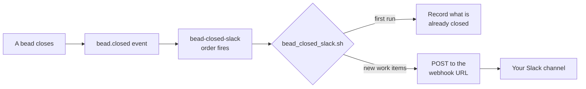

# Slack Notifications

## Contents

- [Objective](#objective)
- [Prereqs](#prereqs)
- [Context](#context)
- [Lab timing](#lab-timing)
- [Try It](#try-it)
  - [1. Pick a Slack workspace you can install apps in](#1-pick-a-slack-workspace-you-can-install-apps-in)
  - [2. Create the app from the manifest](#2-create-the-app-from-the-manifest)
  - [3. Add a webhook to a channel](#3-add-a-webhook-to-a-channel)
  - [4. Put the URL in the city's .env](#4-put-the-url-in-the-citys-env)
  - [5. Install the pack and record the baseline](#5-install-the-pack-and-record-the-baseline)
  - [6. Send a test post](#6-send-a-test-post)
  - [7. Sling a bead and watch the post arrive](#7-sling-a-bead-and-watch-the-post-arrive)
  - [8. Reflect](#8-reflect)
- [Verification](#verification)
- [Troubleshooting](#troubleshooting)
- [Going further](#going-further)
- [What's next](#whats-next)

## Objective

By the end of this lab your factory posts to a Slack channel each time it closes a piece of work, with the pull request link when the work went through the PR path. You'll have a Slack app of your own with an incoming webhook, the `slack-notify` pack installed on your rig, and one real post in your channel from a bead the factory finished.

## Prereqs

- [W3](../progression/W3-run-your-factory.md) complete: the base factory installed on the `ascii-art` rig, with a bead already through the PR path (`--on mol-polecat-pr`).
- `$SFI_PATH` set in your shell. [W2](../progression/W2-cloud-box-and-preflight.md) appends it to a shell rc, so it survives a new terminal.
- A Slack workspace where you're allowed to install apps. A free workspace you create yourself takes two minutes. The SFI community workspace may not allow app installs, so use your own.
- A browser on your laptop, signed in to that workspace, for the Slack app settings.
- `curl` and `jq` where your factory runs. Both ship on the cloud box. On a laptop, `jq --version` tells you.

**This option needs no other option.** The pack imports nothing and adds no agents, so it sits on top of the base factory alone.

## Context

So far your factory reports where you're already looking: the dashboard, `bd list`, an attached session. Your team doesn't sit in any of those. This lab has the factory report where the team already is.

It's one-way. The factory posts to Slack and Slack never answers, which is the smallest Slack integration there is. An **incoming webhook** is a URL that accepts a JSON `POST` and puts its text in one channel. There's no bot token, no OAuth server and no listener process, so the only new thing on your box is a short script that runs when a bead closes.

The pack is the base factory's `bead-closed-log` order with a channel in place of a file. Same `event` trigger on `bead.closed`, same habit of asking `bd` what is closed and skipping what it has already handled. Open the two order files side by side and the trigger reads the same:

```bash
cat "$SFI_PATH/sf-tutorial/artifacts/packs/base-factory/orders/bead-closed-log.toml"
cat "$SFI_PATH/sf-tutorial/artifacts/packs/slack-notify/orders/bead-closed-slack.toml"
```



The destination is what changes the script. A duplicate line in a log file costs nothing, and a duplicate post is noise in front of your team, so the script carries four things the log script doesn't: a **filter** (a sling closes formula steps too, and only work items post), a **baseline** (the first run posts none of the beads already closed), a **burst cap** (more than five closes in one firing become one summary message) and care with the **secret**. The [pack README](../artifacts/packs/slack-notify/README.md) has a row for each.

The webhook URL is that secret. Anyone holding it can post into your channel, and Slack revokes webhook URLs it finds in public repositories. So it lives in your city's `.env`, `.env` goes in `.gitignore`, and the script never prints it.

## Lab timing

Forty-five minutes. About fifteen go on the Slack side in your laptop browser (steps 1 to 3), five on installing the pack, and the rest on one bead going through the PR path while you watch the channel.

## Try It

### 1. Pick a Slack workspace you can install apps in

Use a workspace you own. No workspace yet? Create a free one at [slack.com/get-started](https://slack.com/get-started#/createnew); all it asks for is an email address, and it's yours in about two minutes.

Then make a channel for the factory, such as `#factory`, so the posts stay out of everyone's way while you experiment.

### 2. Create the app from the manifest

The pack ships the app's whole configuration as a manifest. You paste one file, and Slack does the clicking.

1. On your laptop, open [`slack-app-manifest.json`](../artifacts/packs/slack-notify/assets/slack-app-manifest.json) on GitHub and press **Copy raw file**.
2. Go to [api.slack.com/apps](https://api.slack.com/apps) and choose **Create New App**, then **From a manifest**.
3. Pick your workspace, choose the **JSON** tab, replace what's there with the manifest, and continue through **Next** to **Create**.

That's the whole app. It has one scope, `incoming-webhook`, with incoming webhooks switched on, and nothing else at all: no Socket Mode, no event subscriptions, nothing that sits and listens for messages.

### 3. Add a webhook to a channel

In the app's settings, open **Incoming Webhooks**. The toggle's already on.

Choose **Add New Webhook** (some screens say **Add New Webhook to Workspace**), pick the channel from step 1, and **Allow**. Your URL shows up in the table at the bottom of the page, starting `https://hooks.slack.com/services/`. Copy it. From here on, treat it like a password.

### 4. Put the URL in the city's .env

An exec order never loads `.env`, so the pack's script reads the city's `.env` file itself. Run these on the machine your factory runs on:

**Copy and paste**

```bash
cd "$SFI_PATH/factory1"
grep -qxF .env .gitignore || echo .env >> .gitignore
printf 'Paste the webhook URL, then press Enter: '; read -r URL
echo "SLACK_WEBHOOK_URL=$URL" >> .env; unset URL
grep -c '^SLACK_WEBHOOK_URL=https://hooks.slack.com/services/' .env
```

**Expected output**

```text
1
```

The second line adds `.env` to the `.gitignore` that `gc init` wrote without it, so the URL stays out of any commit if the city ever goes under git. Pasting into `read` keeps the URL out of your shell history. The last line checks the URL landed without printing it.

### 5. Install the pack and record the baseline

Rig scope, like the base factory's orders, so the pack posts the rig's work and none of the city's own housekeeping.

**Copy and paste**

```bash
cd "$SFI_PATH/factory1"
gc import add --rig ascii-art "$SFI_PATH/sf-tutorial/artifacts/packs/slack-notify"
gc reload
gc order list | grep bead-closed-slack
```

**Expected output**

```text
bead-closed-slack    exec     event        bead.closed     ascii-art       -
```

Now fire it once by hand. The first run records every bead already closed on the rig and posts none of them, so your channel doesn't fill with the day's history:

**Copy and paste**

```bash
gc order run bead-closed-slack
```

**Expected output**

```text
slack-notify: first run on ascii-art: 9 closed bead(s) recorded as already seen, none posted
Order "bead-closed-slack" executed (exec)
```

Your count will be different. If all you see is the `Order "bead-closed-slack" executed (exec)` line, the controller beat you to it: a new event order in a factory that has closed anything fires on the next tick, and that firing recorded the baseline for you. Either way, nothing's reached Slack yet. The list is plain text, one bead id per line:

**Copy and paste**

```bash
wc -l < "$SFI_PATH/factory1/.gc/runtime/packs/slack-notify/ascii-art/sent"
```

### 6. Send a test post

Now close a throwaway bead and fire the order yourself:

**Copy and paste**

```bash
cd "$SFI_PATH/ascii-art"
TEST_ID=$(bd create --title "Try the Slack notifications pack" --type task --priority 3 --json | jq -r '.id')
bd close "$TEST_ID"

cd "$SFI_PATH/factory1"
gc order run bead-closed-slack
```

**Expected output**

```text
slack-notify: posted 1 closed bead(s) from ascii-art in 1 message(s)
Order "bead-closed-slack" executed (exec)
```

In your channel:

```text
✅ Closed on ascii-art: `aa-k3x` Try the Slack notifications pack
```

Run `gc order run bead-closed-slack` again and you'll get just the `executed` line. The bead's on the sent list now, so nothing new goes out.

You fired that one by hand for a reason. The controller notices closes on its own cadence, roughly once a minute, and a bead that's created and closed inside the same window can slip past without an event. Real work sits open for minutes before it closes, so this only bites quick tests like this one. A by-hand firing doesn't need the event at all; the script just asks `bd` what's closed.

### 7. Sling a bead and watch the post arrive

Find a letter that's still in the queue:

**Copy and paste**

```bash
cd "$SFI_PATH/ascii-art"
bd list --type=task --status=open --limit 0 | grep "Implement"
```

Then sling it through the PR path, the way W3 did:

**Copy and paste**

```bash
cd "$SFI_PATH/factory1"
gc sling ascii-art/base-factory.polecat <bead-id> --on mol-polecat-pr
```

Keep the channel open while the factory works, which takes a few minutes. The polecat writes the file and hands the bead to the refinery, the architect reviews it, and the refinery opens a pull request and closes the bead. That close fires the order, and within a minute or so you'll see:

```text
✅ Closed on ascii-art: `aa-7ln.8` Implement h.md · PR #4
```

`PR #4` links to the pull request. Heads up: the bead closes when the PR opens, so treat the post as your cue to go review it. Merge it the way you did in W3.

**What to notice.** That one sling closed more beads than the one you slung: the `mol-polecat-pr` workflow's steps and the convoy around the sling close too, and you can list them with `bd list --status closed --limit 0` in the rig. Still, only one message arrived, since the script posts just the kinds of bead a person creates or slings.

### 8. Reflect

Your factory now reports to the place your team already reads, and the order that does it is the one you met in W3 with a different action.

The changes all came from the destination. Once the output goes in front of people, the script needed a filter, a baseline, a cap on bursts, and a secret it never prints. That's worth carrying into your own orders: the trigger is the easy half, and the action owes its readers whatever they'd notice going wrong.

What's still missing: Slack can't talk back. A teammate who sees a post can't reply "do this next" and have it become work. [Going further](#going-further) covers that.

## Verification

**Copy and paste**

```bash
cd "$SFI_PATH/factory1"
gc order list | grep bead-closed-slack
gc order history bead-closed-slack | head -5
grep -qxF .env .gitignore && echo ".env is ignored"
```

**Expected output**

```text
bead-closed-slack    exec     event        bead.closed     ascii-art       -
ORDER                RIG             BEAD            EXECUTED
bead-closed-slack    ascii-art       aa-wisp-520     2026-10-15T14:11:20Z
bead-closed-slack    ascii-art       aa-wisp-pez     2026-10-15T14:08:19Z
...
.env is ignored
```

Your channel holds the test post from step 6 and the post for the bead from step 7, with its PR link.

## Troubleshooting

- **`gc order run bead-closed-slack` prints only the `executed` line and nothing arrives.** Either nothing new has closed, or the script found no URL. `grep -c '^SLACK_WEBHOOK_URL=' "$SFI_PATH/factory1/.env"` should print `1`. The script reads the city's `.env`, not the rig's.
- **`gc order list` has no `bead-closed-slack`.** The import or the reload didn't land. `gc import list --rig ascii-art` should list `slack-notify`; run `gc reload` again. If it says the controller is busy, wait a tick and retry.
- **`posting ... failed (HTTP 403)` or `(HTTP 404)`.** Slack refused the URL: the webhook was removed, the app was uninstalled, or Slack revoked a URL it found in a public repository. Add a new webhook (step 3) and replace the `SLACK_WEBHOOK_URL` line in `.env`. The beads that failed post on the next firing.
- **`posting ... failed (HTTP 000 ...)`.** Slack never answered. Check the machine can reach `hooks.slack.com`. Nothing is lost: the beads wait for the next firing.
- **A failure you didn't see happen.** When the controller fires the order and it fails, `gc events --type order.failed --since 1h` shows the script's message.
- **The first bead you closed after installing never posted.** The factory had closed nothing before you installed and you skipped the baseline run in step 5, so the first firing recorded that bead as already seen. Everything closed after it posts.

## Going further

The two-way bridge, where a message in Slack becomes a bead and the factory answers in the thread, is what the instructors' factory runs, and you'll see it live. It's a different shape of project: a long-running listener holding a Socket Mode connection, a bot token, and an agent that reads what the listener hears and decides what to do with it. There are no install steps for it in this tutorial.

## What's next

The Day 2 options are a menu, so take them in whatever order solves a problem you actually have. Every one installs on the base factory alone. The full list is in [the feature labs](../progression/L3-L5-feature-labs.md).

Pairs well with the [self-improvement loop](./05-self-improvement-loop.md): once the factory can post, the channel your team reads is a natural place for its daily look at itself to report what it found.

« [back to the feature labs](../progression/L3-L5-feature-labs.md) »
