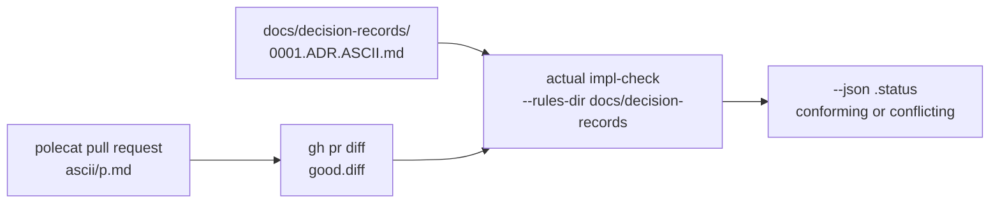

# Architecture Agent with the Actual CLI

## Contents

- [Objective](#objective)
- [Prereqs](#prereqs)
- [Context: an ADR the CLI can check](#context-an-adr-the-cli-can-check)
- [How the lab runs](#how-the-lab-runs)
- [Try It](#try-it)
  - [1. Start a polecat on a letter](#1-start-a-polecat-on-a-letter)
  - [2. Install the actual CLI](#2-install-the-actual-cli)
  - [3. Install the Claude Code plugin](#3-install-the-claude-code-plugin)
  - [4. Put the new ADR 0001 in your rig](#4-put-the-new-adr-0001-in-your-rig)
  - [5. List the rules the CLI reads](#5-list-the-rules-the-cli-reads)
  - [6. Check the polecat's diff](#6-check-the-polecats-diff)
  - [7. Break a rule and check again](#7-break-a-rule-and-check-again)
  - [8. Ask Claude Code to read the verdict](#8-ask-claude-code-to-read-the-verdict)
  - [9. Reflect](#9-reflect)
- [Verification](#verification)
- [Ceiling](#ceiling)
- [Troubleshooting](#troubleshooting)
- [What's next](#whats-next)

## Objective

Put your rig's ADR 0001 in the rule format the Actual CLI reads, install the CLI and its Claude Code skill, and run `actual impl-check` on two diffs from your factory: a polecat's letter that follows the ADR, which comes back `conforming`, and the same letter stretched past the size bound, which comes back `conflicting` and names the rule it breaks.

## Prereqs

- [W3](../progression/W3-run-your-factory.md) complete: the base factory installed on the `ascii-art` rig, and a polecat that can open a pull request.
- `$SFI_PATH` set in your shell. [W2](../progression/W2-cloud-box-and-preflight.md) appends it to a shell rc, so it survives a new terminal. Every other path on this page is written out from it.
- Claude Code installed and signed in. `impl-check` uses it as the model that judges a diff, and a Claude subscription is enough. You need no Actual AI account for anything on this page.
- `gh` signed in and `jq` installed, both from W2.

**Codex only?** Steps 1, 2, 4 and 5 work as written. Step 3 is a Claude Code plugin, and steps 6 and 7 can't run on CLI v0.7.0 with Codex alone: its Codex runner calls `codex exec --full-auto`, current Codex rejects that flag, and the check reports `not_checked` instead of a verdict. Pair with someone signed in to Claude Code for steps 3 and 6 to 8.

**This option needs no other option.** It reads what the base factory already produces: your ADRs and a polecat's pull request.

## Context: an ADR the CLI can check

The architect in the base factory reads your decision records as prose and returns one judgment for the whole diff. The Actual CLI reads the same records as a list of named rules, checks a diff against each rule, and returns a verdict per rule plus one overall `status`. That makes three things possible that prose can't give you: a verdict that cites `ART-2` instead of paraphrasing the ADR, a check that runs wherever a diff exists, and a field a gate can branch on.



The CLI reads a folder of markdown files. Each one needs a `### Rules` section of bullets shaped `- **ID** LEVEL: statement`, where `LEVEL` is `MUST`, `MUST NOT`, `SHOULD`, `SHOULD NOT` or `MAY`, and a file without that section gets rejected outright. Everything else is optional, though you'll want most of it: a `# Title`, a one-sentence scope line right under it, a `### Verify` block whose commands name the paths the rules govern (those paths are how the CLI decides which changes a file applies to), and an `**Accept when:**` list. Here's part of the converted 0001:

```markdown
# ADR 0001: ASCII Art Markdown File Constraints

These rules apply to every ASCII art markdown file in `ascii/` at the repository root.

### Rules

**ASCII art constraints**

- **ART-1** MUST: The ASCII art inside the code block is at most 40 lines tall, not counting the fence lines.
- **ART-2** MUST: The ASCII art inside the code block is at most 40 columns wide, measured as the character count of its longest line.
```

The constraints are the ones 0001 always had. What's new is the ID on each, which names its group and its number in that group: `ART-2` is the second ASCII art constraint.

Two placement facts shape how this lab is wired:

- **The CLI doesn't read status lines.** Any file in the folder that parses is enforced, whatever its `Status` says. So a proposed ADR waits in `docs/future/`, where the tutorial already keeps 0002.
- **The ADRs stay in `docs/decision-records/`.** The CLI's default folder is `.actual/rules/` at the repository root, and the Claude Code plugin's hooks gate every turn of every Claude session in a repository that has rule files there. Your polecats are Claude sessions in the rig. Keep the rules where your architect already reads them, then, and pass `--rules-dir` to every command, as this page does.

You won't need the CLI's other two commands today. `adr-bot` works from Actual AI's own ADR bank instead of your repository's records, and `advisor` wants an Actual AI login.

## How the lab runs

Forty-five minutes, setup included. Step 1 starts a polecat before anything else, because the factory can take a while (ten minutes, or longer on a busy box) to open its pull request, and the installs fill the wait. Each `impl-check` call takes roughly a minute.

## Try It

### 1. Start a polecat on a letter

The lab uses `p.md`, since no other page builds it. Like every sling at the polecat, this one carries `--on mol-polecat-pr`, so the work comes back as a pull request instead of landing on `main`.

**Copy and paste**

```bash
cd "$SFI_PATH/ascii-art"
export BEAD_ID=$(bd list --type=task --status=open --limit 0 --json | jq -r '.[] | select(.title == "Implement p.md") | .id')
echo "$BEAD_ID"

cd "$SFI_PATH/factory1"
gc agent list --rig ascii-art       # the polecat is ascii-art/base-factory.polecat
gc sling ascii-art/base-factory.polecat "$BEAD_ID" --on mol-polecat-pr
```

If `echo` prints nothing, your factory probably built `p.md` already. Pick any letter whose bead is still open and that you haven't slung, and put its title in the `select`.

Keep this terminal open. Steps 6 and 7 read `$BEAD_ID` from it.

### 2. Install the actual CLI

It's a single binary, so installing it just means putting release v0.7.0 in a folder on your `PATH`.

**On your own Mac**, that's `~/.local/bin`, where W2's `deps.sh` put `gc`. On an Intel Mac, swap in `actual-darwin-x64.tar.gz`.

**Copy and paste**

```bash
mkdir -p ~/.local/bin
curl -fsSL https://github.com/actual-software/actual-releases/releases/download/v0.7.0/actual-darwin-arm64.tar.gz | tar -xz -C ~/.local/bin
actual --version
```

**On a cloud box**, it goes in `/usr/local/bin`:

**Copy and paste**

```bash
curl -fsSL https://github.com/actual-software/actual-releases/releases/download/v0.7.0/actual-linux-x64.tar.gz | sudo tar -xz -C /usr/local/bin
actual --version
```

If `sudo` asks for a password you don't have, install into your home folder instead:

```bash
mkdir -p ~/.local/bin
curl -fsSL https://github.com/actual-software/actual-releases/releases/download/v0.7.0/actual-linux-x64.tar.gz | tar -xz -C ~/.local/bin
export PATH="$HOME/.local/bin:$PATH"
actual --version
```

**Expected output**

```text
actual 0.7.0
```

### 3. Install the Claude Code plugin

The plugin carries the `actual` skill, which teaches Claude Code the CLI's commands, flags and verdicts. It also brings the hooks from [Context](#context-an-adr-the-cli-can-check), and with no rule files in `.actual/rules/` they won't do anything.

**Copy and paste**

```bash
claude plugin marketplace add actual-software/actual-skill
claude plugin install actual-cli@actual-cli-skills
claude plugin list
```

**Expected output** (the end of it)

```text
  ❯ actual-cli@actual-cli-skills
    Version: 1.4.0
    Scope: user
    Status: ✔ enabled
```

You'll also see `6 userConfig options not yet set`. Those just tune the hooks, which this lab leaves idle, so you can skip them.

### 4. Put the new ADR 0001 in your rig

The 0001 that W3 copied into your rig predates the `### Rules` section. Pull the tutorial and copy the converted file over it.

**Copy and paste**

```bash
git -C "$SFI_PATH/sf-tutorial" pull --ff-only
cp "$SFI_PATH/sf-tutorial/artifacts/docs/decision-records/0001.ADR.ASCII.md" "$SFI_PATH/ascii-art/docs/decision-records/"
git -C "$SFI_PATH/ascii-art" diff --stat
```

**Expected output**

```text
 docs/decision-records/0001.ADR.ASCII.md | 78 +++++++++++++++++++--------------
 1 file changed, 46 insertions(+), 32 deletions(-)
```

It's worth a minute with `git -C "$SFI_PATH/ascii-art" diff` to watch the old numbered lists turn into the `### Rules` section. Thirteen constraints, thirteen rules. The size bound is still 40 lines by 40 columns, and the tutorial's `docs/future/0002.ADR.TESTING.md` now says the same, so the two records finally agree.

The CLI reads the file straight from disk, so nothing here waits on a commit; you'll commit it in [step 9](#9-reflect).

### 5. List the rules the CLI reads

`actual rules ls` takes a repository root and lists whatever it finds in that root's `.actual/rules/`. There's no flag to aim it elsewhere, so give it a small root of its own outside the rig, whose `.actual/rules` is just a link to `docs/decision-records`:

**Copy and paste**

```bash
mkdir -p "$SFI_PATH/adr-lab/view/.actual"
ln -sfn "$SFI_PATH/ascii-art/docs/decision-records" "$SFI_PATH/adr-lab/view/.actual/rules"
actual rules ls "$SFI_PATH/adr-lab/view"
```

**Expected output**

```text
╭─ Rules ──────────────────────────────────────────────────────────────────────╮
│ $SFI_PATH/adr-lab/view/.actual/rules                                         │
├──────────────────────────────────────────────────────────────────────────────┤
│ 0001.ADR.ASCII: MUST 13                                                      │
├──────────────────────────────────────────────────────────────────────────────┤
│ 1 document · 13 rules · 0 warnings · 0 errors                                │
╰──────────────────────────────────────────────────────────────────────────────╯
```

**What to notice.** Point the same command at the old file and it'd report `no ### Rules section` and `0 documents`. A record the CLI can't parse gets skipped and reported, never half-read, so `0 errors` here is your check that every ADR in the folder is in force. `docs/future/0002.ADR.TESTING.md` sits outside the folder, which keeps it out of the count.

### 6. Check the polecat's diff

First, the pull request from step 1. This loop checks the bead every twenty seconds and prints the URL once the factory has recorded it, which takes a while if the polecat's still working.

**Copy and paste**

```bash
cd "$SFI_PATH/ascii-art"
until PR_URL=$(bd show "$BEAD_ID" --json | jq -r '.[0].metadata.pr_url // empty') && [ -n "$PR_URL" ]; do sleep 20; done
echo "$PR_URL"
gh pr diff "$PR_URL" > "$SFI_PATH/adr-lab/good.diff"

actual impl-check --rules-dir docs/decision-records --diff-file "$SFI_PATH/adr-lab/good.diff" --json > "$SFI_PATH/adr-lab/good.json"
jq -r .status "$SFI_PATH/adr-lab/good.json"
jq -r '.verdicts[] | "\(.rule_id)  \(.verdict)"' "$SFI_PATH/adr-lab/good.json"
```

**Expected output**

```text
conforming
LOC-1  conforming
LOC-2  conforming
...
RHYME-3  conforming
```

`impl-check` picked 0001 because the diff touches `ascii/p.md`, and the ADR's `### Verify` block names `ascii/`. Then it had Claude Code judge the diff against each rule. Every verdict carries a one-line `reason`, and it's worth reading two or three: `jq '.verdicts[0:3]' "$SFI_PATH/adr-lab/good.json"`.

### 7. Break a rule and check again

Now make a second diff from the first. The `awk` line stretches the art's first line by 40 characters, which pushes it past ART-2's 40 columns whatever the polecat drew.

**Copy and paste**

```bash
cd "$SFI_PATH/adr-lab"
awk '/^\+```text$/ {print; getline; print $0 "########################################"; next} {print}' good.diff > bad.diff
diff good.diff bad.diff

cd "$SFI_PATH/ascii-art"
actual impl-check --rules-dir docs/decision-records --diff-file "$SFI_PATH/adr-lab/bad.diff" --json > "$SFI_PATH/adr-lab/bad.json"
jq -r .status "$SFI_PATH/adr-lab/bad.json"
jq -r '.verdicts[] | select(.verdict != "conforming") | "\(.rule_id): \(.reason)"' "$SFI_PATH/adr-lab/bad.json"
```

**Expected output** (your art, its width and the wording will differ)

```text
╭─ Error ──────────────────────────────────────────────────────────────────────╮
│                                                                              │
│ Error: implementation does not conform: ART-2: ART-2 requires at most 40 co… │
│                                                                              │
╰──────────────────────────────────────────────────────────────────────────────╯
conflicting
ART-2: ART-2 requires at most 40 columns; this line is 52 characters wide (12 leading characters plus 40 `#` characters), exceeding the limit.
```

The error panel is `impl-check` reporting the conflict on stderr. The judge is a model, so now and then a judgment rule such as RHYME-2 comes back `conflicting` too; ART-2 is the one the stretched line guarantees.

**What to notice.** Read the verdict from `.status`, never from the exit code. `impl-check` only exits non-zero on a real conflict, like this one. It exits 0 for `conforming`, for `requires_decision`, and for `not_checked`, and that last one means no check happened at all: no runner was found, no rule applied, or the judging call failed. A gate that trusts exit 0 can't tell those three apart.

### 8. Ask Claude Code to read the verdict

The skill's the other half of the setup. It's what lets an agent run these checks and act on the answer, so try it: start Claude Code in the rig.

**Copy and paste**

```bash
cd "$SFI_PATH/ascii-art"
claude
```

Ask it, in your own words:

> Use the actual skill to run impl-check on $SFI_PATH/adr-lab/bad.diff with --rules-dir docs/decision-records. Which rule fails, and what is the smallest change to the art that fixes it?

Expect it to run the command from step 7, name ART-2, and suggest trimming the stretched line back under 40 columns. Exit with `/exit` when you're done.

**What to notice.** The skill is general guidance about the CLI, written for any repository, and it's still enough for Claude Code to find the right command, pass `--rules-dir` and read `.status`. A polecat or a reviewer agent with the same plugin could do it too.

### 9. Reflect

Your factory's now got two readings of one ADR. The architect reads it as prose and gives a judgment. The CLI reads it as thirteen named rules and hands back a verdict per rule, plus a status a script can branch on.

They're good at different things. The architect can weigh what no rule spells out, like whether the art looks like its letter, which 0001 deliberately leaves alone. The CLI sticks to what the `### Rules` section says, and it'll name the rule behind each verdict. Both lean on a model to judge, so neither one replaces a deterministic check like the CI workflow 0002 describes. That's worth a capability-map row: which of them should decide a merge in your factory, and why?

Before you go, keep the converted ADR. Commit `docs/decision-records/0001.ADR.ASCII.md` to the rig the way it takes any doc change: straight to `main`, or as a pull request if you installed [branch protection](../appendix/03-branch-protection.md).

## Verification

**Copy and paste**

```bash
actual --version
actual rules ls "$SFI_PATH/adr-lab/view" | grep document
jq -r .status "$SFI_PATH/adr-lab/good.json" "$SFI_PATH/adr-lab/bad.json"
```

**Expected output**

```text
actual 0.7.0
│ 1 document · 13 rules · 0 warnings · 0 errors                                │
conforming
conflicting
```

## Ceiling

Put the check inside the factory. The natural place is a review lane's load-context step, such as the ADR lane's in the [domain reviewers](./02-specialize-reviewers-per-domain.md) option: run `impl-check --json` on the bead's diff and hand the reviewer the per-rule verdicts with the ADR. Budget a few hours for it, because the lane's prompt and its pass or fail handling both change. `actual plan-check` is the same check for a plan before any code exists, and it takes the same `--rules-dir`.

## Troubleshooting

- **`actual --version` prints an older version, or `command not found`.** Another install comes first on your `PATH`, or the folder you installed into isn't on it. `which -a actual` lists every copy in order. Put `~/.local/bin` (or `/usr/local/bin`) first, or call the new one by its full path.
- **`.status` is `not_checked`.** No runner was available or the judging call failed. Run `actual runners` and check that `claude` is installed and signed in. On Codex alone this is expected on v0.7.0; see [Prereqs](#prereqs).
- **`rules ls` reports `0002.ADR.DESIGN.md: no ### Rules section`.** You kept the demo ADR from [Hardening 2](./02-specialize-reviewers-per-domain.md). Delete it as that page says, or give it a `### Rules` section of its own.
- **`rules ls` reports `0 documents` and no errors.** The link points somewhere empty. `ls -l "$SFI_PATH/adr-lab/view/.actual/rules"` shows where it goes; re-run step 5's `ln` line.
- **The step 6 loop never ends.** The factory hasn't recorded a pull request on the bead yet. Watch the run on the dashboard or with `gc session list`. If you'd rather not wait, use a pull request your polecat opened on Day 1: `gh pr list --state all` lists them, and `gh pr diff <number> > "$SFI_PATH/adr-lab/good.diff"` stands in for step 6's `until` loop and its `gh pr diff` line.
- **`diff good.diff bad.diff` prints nothing.** The polecat's change edits a file that already existed instead of adding one, so `good.diff` has no added `` ```text `` line for the `awk` to find. Use a diff that adds a letter file, or lengthen one added art line in `bad.diff` by hand.
- **`claude plugin install` reports that the marketplace is not found.** The `marketplace add` line didn't run or failed. `claude plugin marketplace list` shows the marketplaces you have.
- **Plan or diff gates start firing in your Claude sessions.** Something put rule files where the plugin's hooks look: an `.actual/rules/` folder in the repository, or an `ACTUAL_RULES_DIR` variable in the environment. Remove it; this lab only ever passes the folder with `--rules-dir`.

## What's next

This is one of the Day 2 options, and they are a menu rather than a sequence. Every one installs on the base factory alone, so take them in whatever order solves a problem you actually have. The full list is in [the feature labs](../progression/L3-L5-feature-labs.md#the-six-options).

« [back to the feature labs](../progression/L3-L5-feature-labs.md) »
