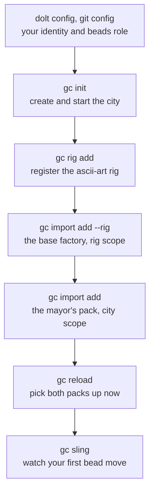
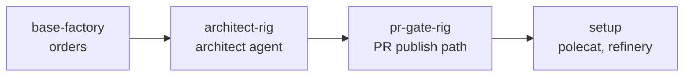

# W3 · Run Your Factory

**Workshop · 60 minutes · Day 1**

## Contents

- [Objective](#objective)
- [Prereqs](#prereqs)
- [Context](#context)
- [Setup](#setup)
  - [1. Set your identity and beads role](#1-set-your-identity-and-beads-role)
  - [2. Create the city](#2-create-the-city)
  - [3. Read what `gc init` wrote](#3-read-what-gc-init-wrote)
  - [4. Confirm Dolt is running](#4-confirm-dolt-is-running)
  - [5. Register the ascii-art rig](#5-register-the-ascii-art-rig)
  - [6. Add the starting docs](#6-add-the-starting-docs)
  - [7. Put the rig on GitHub](#7-put-the-rig-on-github)
  - [8. Install the base factory](#8-install-the-base-factory)
  - [9. Run the factory checks](#9-run-the-factory-checks)
  - [10. Seed the beads queue](#10-seed-the-beads-queue)
- [Try It](#try-it)
  - [1. Sling your first bead](#1-sling-your-first-bead)
  - [2. Attach to a session and watch it move](#2-attach-to-a-session-and-watch-it-move)
  - [3. Watch the orders fire](#3-watch-the-orders-fire)
  - [4. Watch it work](#4-watch-it-work)
  - [5. Reflect](#5-reflect)
- [Verification](#verification)
- [Troubleshooting](#troubleshooting)
- [What's next](#whats-next)

## Objective

By the end of this session you have a running software factory of your own: a city called `factory1`, a rig called `ascii-art` pushed to GitHub, the base factory pack installed, a seeded queue of work, and your first bead moving through the pipeline while you watch it.

This is the factory you build on for the rest of the curriculum. Everything from here either tours it, observes it, or extends it.

## Prereqs

- [W2](./W2-cloud-box-and-preflight.md) complete on one of its two paths. That leaves you a terminal, on your cloud box or on your own machine, with `gc`, `bd` and `dolt` installed, your coding agent and `gh` signed in, and this tutorial cloned into `$SFI_PATH`.

## Context

You are not assembling a factory by hand today. The base factory arrives as one pack, and it already contains a worked example of every Gas City primitive, so the rest of Day 1 is spent reading a factory that runs rather than debugging one that half does. [W4](./W4-tour-the-factory.md) will walk through the pieces in more detail.

The factory lives wherever your terminal is. On a cloud box that's the box: the city, the rig, the Dolt database and every agent session run there, and your laptop only holds the terminal `sfbox ssh` opened. On your own machine it's all on your laptop.



**Directory tree**, on whichever machine you build the factory on

```text
~/
 └── software-factory-intensive/
     ├── sf-tutorial/
     ├── factory1/                    # gc init puts the city here.
     ├── ascii-art/                   # gc rig add puts the rig here.
     └── <your projects>              # Your own work can live here too.
```

## Setup

Every step on this page runs in the terminal W2 left you in: the box's terminal that `sfbox ssh <box>` opens, or a terminal on your own machine. The commands are the same in both, apart from opening the dashboard in [Try It step 4](#4-watch-it-work). The expected output comes from a cloud box, and wherever the older `gc` that W2 installs on your own machine prints something different that matters, the step says so. If that terminal has closed, open a new one the same way. `echo "$SFI_PATH"` should print your workspace, `/home/ubuntu/software-factory-intensive` on a box.

### 1. Set your identity and beads role

`gc init` stops before starting the city when Dolt has no author identity. `git` signs the rig's commits with whatever name it can guess, which on a box is `Ubuntu <ubuntu@box-…internal>`. And `gc doctor` reports an error until `beads.role` is set. The box doesn't set any of them, so set them now, with your own name and the email on your GitHub account, so the rig's commits show up as yours:

**Copy and paste**

```bash
dolt config --global --add user.name "Your Name"
dolt config --global --add user.email "you@example.com"
git config --global user.name "Your Name"
git config --global user.email "you@example.com"
git config --global beads.role maintainer
```

Each `dolt` line answers `Config successfully updated.` The `git` lines print nothing. On your own machine `git` may already know who you are, and if `git config --global user.email` prints your address you can skip the two `user.` lines for `git`.

All five are per-user settings, so you set them once per machine, and running them again just replaces the values. `maintainer` tells `bd` that you own the repositories it tracks, so it keeps their issues in place. For a contributor's fork it would route them to a separate planning repository instead.

### 2. Create the city

Create the `factory1/` directory with an auto-generated `city.toml` and `pack.toml`, and start it.

**Copy and paste**

```bash
cd "$SFI_PATH"
gc init factory1
```

At `Template [1]:`, type `2` for the **minimal** template. The wizard then lists the coding agents you're signed in to. With one, it picks that agent and carries on. With more than one, it asks `Agent:`, and you type the number of the one you want. If it lists none, it stops with `no configured coding agents found`: sign in to your agent the way W2 describes, then run `gc init factory1` again.

The first `gc` command you run on a new box or machine may open with a short note about anonymous usage metrics, before the wizard starts. `gc metrics off` turns them off if you'd rather.

**Expected output** (on a cloud box, signed in to Claude Code only)

```text
Welcome to Gas City SDK!

Choose a config template:
  1. gascity   — planning & implementation skills pack (default)
  2. minimal   — default coding agent
  3. gastown   — multi-agent orchestration pack
  4. custom    — empty workspace, configure it yourself
Template [1]: 2

Choose your coding agent:
  1. Claude Code
If you don't see your coding agent, configure it and restart the wizard.
[1/8] Creating runtime scaffold
[2/8] Installing hooks (Claude Code)
[3/8] Writing default prompts
[4/8] Writing pack.toml
[5/8] Writing city configuration
Created minimal config (Level 1) in "factory1".
[6/8] Checking provider readiness
[7/8] Registering city with supervisor
Registered city 'factory1' (/home/ubuntu/software-factory-intensive/factory1)
Enabled systemd lingering for ubuntu so the supervisor survives logout.
Installed systemd service: /home/ubuntu/.local/share/systemd/user/gascity-supervisor.service
[8/8] Waiting for supervisor to start city
  Adopting sessions...
```

`[7/8]` and `[8/8]` register `factory1` with the supervisor and start it, so the city is running when your prompt comes back. The supervisor brings up Dolt and the agents with it. The two lines about the service appear only the first time a supervisor starts on a machine, and on a Mac it sets up launchd rather than systemd. **Leave Dolt to `gc` and `bd` from here on, and don't run `bd dolt start` yourself.** See [Troubleshooting](#troubleshooting) if you hit Dolt errors.

On your own machine, a city you registered earlier, such as the [Actual Factory Demo](../README.md#actual-factory-demo) from the workshop prerequisites, adds a warning after `[7/8]`: `gc init` reconciles the supervisor that already manages that city, worded in terms of a kill-and-respawn that "cycles those cities' in-flight work", followed by `Continue? [y/N]:`. **Answer `y`.** In practice the supervisor keeps the same PID and the other city stays healthy. The capital `N` is the default, so pressing Enter declines, and `gc init` stops with `aborted by user`.

If `gc init` stops before `[8/8]`, whether at that prompt or on something it names, the city's files exist and nothing is running. Fix what it names, then run `gc start` from inside `factory1/`. A missing Dolt identity is the usual cause, and [Troubleshooting](#gc-init-stops-at-dolt-author-identity) has its exact message.

**Copy and paste**

```bash
cd factory1/
gc status
gc session list
```

**Expected output** (`gc status`, trimmed)

```text
factory1  <your-home>/software-factory-intensive/factory1
  Controller: supervisor-managed (PID 2510)
  Authority: supervisor process PID 2510
  Suspended:  no

Agents:
  bd.dog                  scaled (min=0, max=2)
    bd.dog-1              unknown  (partial status)
    bd.dog-2              unknown  (partial status)
  core.control-dispatcher  unknown  (partial status)
  mayor                   scaled (min=0, max=1)
    mayor                 running
...
Named sessions:
  mayor                   active (always)
```

The lines that matter are `Controller: supervisor-managed`, and the `mayor` line under `Named sessions` reading `active (always)`. In the first minute or so the other agents can read `unknown (partial status)`, and a last line can say the reconciler may be lagging, while the city finishes starting. The `dog` helpers start and stop on their own as there's work. `gc session list` shows one row per running session: the mayor's, and often a `bd.dog` helper's.

### 3. Read what `gc init` wrote

**Copy and paste**

```bash
cat pack.toml
cat city.toml
```

`pack.toml` describes what your city imports and which sessions it runs:

```toml
[pack]
name = "factory1"
schema = 2

[imports]
[imports.bd]
source = "https://github.com/gastownhall/gascity/tree/main/examples/bd"
version = "sha:f895c0ff47d6ee9334ed282a416387eb5b084d24"
[imports.core]
source = "https://github.com/gastownhall/gascity/tree/main/internal/bootstrap/packs/core"
version = "sha:f895c0ff47d6ee9334ed282a416387eb5b084d24"

[[named_session]]
template = "mayor"
mode = "always"
```

The `source` and `version` lines track the `gc` you have, so yours may differ, and the older `gc` that W2 installs on your own machine writes each `source` as a `.git//` path. What matters is the shape:

- **`[imports]`** pins the two builtin packs every city gets: `bd` for the issue tracker and `core` for the base agent set. Imports are what make agents available to `factory1` and its rigs.
- **`[[named_session]]`** declares the always-on `mayor` you will talk to later in this session.
- **There is no `[[agent]]` table, and there should not be.** Agents are discovered from the packs you import and from the city's `agents/` directory, which is where `gc init` put the mayor, so a schema-2 pack declares imports rather than individual agents.

`city.toml` for the minimal template is a few lines, plus a commented-out `[mail]` example you can leave alone, and it grows a `[[rigs]]` entry in step 5:

```toml
[workspace]
provider = "claude"

[providers]
[providers.claude]
base = "builtin:claude"
ready_delay_ms = 0
```

If you picked a different agent, `claude` reads `codex` or `gemini` instead.

### 4. Confirm Dolt is running

The city's beads live in a Dolt database whose server is already up. Verify there is exactly one Dolt server for `factory1` and that `bd` can reach it.

**Copy and paste**

```bash
ps aux | grep "dolt sql-server" | grep factory1 | grep -v grep
bd list
```

This is the step whose output depends on where you are. On a cloud box you should see one `dolt sql-server` started with `--config .../factory1/.beads/dolt/config.yaml`. Its parent is a `bd db-proxy-child` process. `bd` started both during `gc init`, and if they ever stop, the next `bd` command starts them again. On your own machine the line ends in `--config .../factory1/.gc/runtime/packs/dolt/dolt-config.yaml` instead, because the toolchain W2 installs there runs an older `gc` that keeps Dolt under the supervisor. Either way, `bd list` should return without error. A fresh city lists nothing yet, or a bead its `dog` helpers are working through, such as `mol-dog-stale-db`.

On the box each rig gets a Dolt server of its own, so a second `bd db-proxy-child` and `dolt sql-server` appear for `ascii-art` once you register it in [step 5](#5-register-the-ascii-art-rig). The `grep factory1` keeps this check to the city's.

> **Don't run `bd dolt start` or `bd dolt stop` on this city.** On a box, `bd dolt stop` stops the server under the city's running agents, and `bd dolt start` can leave a second server over the same data that nothing supervises. Don't go by `bd dolt status` there either: it can report `not running` while the server is up, so `bd list` is the check. On your own machine, `bd dolt start` starts a second Dolt holding a write lock on the same data directory, and the next time the supervisor restarts the city it cannot bring up its own. The `dolt.auto-start` setting in `.beads/config.yaml` only matters there for standalone `bd` use outside a running city, and the supervisor may rewrite it.

### 5. Register the ascii-art rig

Register the rig as a **sibling** of the city rather than a child. This is the project your factory works on.

**Copy and paste**

```bash
cd "$SFI_PATH/factory1"

mkdir ../ascii-art
gc rig add ../ascii-art ascii-art
```

**Expected output**

```text
Adding rig 'ascii-art'...
  Prefix: aa
  Initialized beads database
  Generated routes.jsonl for cross-rig routing
Rig added.
```

`gc rig add` resolves the relative path to an absolute one, creates the directory if it does not exist, initializes the rig's beads, adds a `[[rigs]]` entry naming `ascii-art` to `city.toml`, and writes the absolute path to `.gc/site.toml`.

**Copy and paste**

```bash
gc rig list
```

**Expected output**

```text
Rigs in $SFI_PATH/factory1:

  factory1 (HQ):
    Prefix: fa
    Beads:  initialized

  ascii-art:
    Path:   $SFI_PATH/ascii-art
    Prefix: aa
    Beads:  initialized
```

### 6. Add the starting docs

**Copy and paste**

```bash
cd ../sf-tutorial
mkdir -p "$SFI_PATH/ascii-art/docs/future" \
         "$SFI_PATH/ascii-art/docs/current" \
         "$SFI_PATH/ascii-art/docs/decision-records"

cp "$SFI_PATH/sf-tutorial/artifacts/docs/decision-records/0001.ADR.ASCII.md" \
   "$SFI_PATH/ascii-art/docs/decision-records/"
cp "$SFI_PATH/sf-tutorial/artifacts/docs/future/0002.ADR.TESTING.md" \
   "$SFI_PATH/ascii-art/docs/future/"
```

Those two decision records are what the architect reviews against once the factory starts working. `docs/current/` stays empty for now.

### 7. Put the rig on GitHub

The base factory publishes its work as pull requests, so the rig needs an upstream `main`. Create an empty repository on GitHub using [this link](https://github.com/new?name=ascii-art&description=A%20reference%20project%20for%20a%20software%20factory%20to%20build.), then:

**Copy and paste**

```bash
cd "$SFI_PATH/ascii-art"
git init -b main
git commit --allow-empty -m 'first commit'
git add docs/ .gitignore
git commit -m "Add docs describing initial vision for ASCII Art project"
```

Replace `<your-github-handle>` with the org or user that owns the empty repo:

**Copy and paste**

```bash
git remote add origin https://github.com/<your-github-handle>/ascii-art.git
git push -u origin main
```

**Outcome:** `git status` reports `main` tracking `origin/main`. The one untracked entry it may list is your coding agent's folder, such as `.claude/`, where `gc` keeps the agent's skills for the rig. Leave it untracked.

### 8. Install the base factory

This is the step the whole session is built around. One import brings a complete factory, because packs import transitively and the base pack sits on top of a chain that already carries the rest.

**Copy and paste**

```bash
cd "$SFI_PATH/factory1"
gc import add --rig ascii-art "$SFI_PATH/sf-tutorial/artifacts/packs/base-factory"
```

That single command installs four packs:



One more import goes in at **city** scope rather than rig scope, because it supplies the mayor and the mayor belongs to the city:

**Copy and paste**

```bash
gc import add "$SFI_PATH/sf-tutorial/artifacts/packs/pr-gate-city"
```

That import makes the pack's mayor available. It does not yet run it, and this is the step that is easy to miss.

`gc init` gave the city a mayor of its own, in `agents/mayor/`, and the `[[named_session]]` block you read in step 3 is what runs it. The pack ships a mayor too. Leave both in place and the factory comes up with two: the stock one, and the one that knows about the PR gate.

Hand the role over. Delete the city's mayor, then point the always-on session at the pack's:

**Copy and paste**

```bash
cd "$SFI_PATH/factory1"
rm -rf agents/mayor

sed '/^\[\[named_session\]\]/,/^[[:space:]]*mode = /d' pack.toml > pack.toml.tmp
cat >> pack.toml.tmp <<'EOF'
[[named_session]]
name = "mayor"
template = "pr-gate-city.mayor"
mode = "always"
EOF
mv pack.toml.tmp pack.toml
```

Keeping `name = "mayor"` preserves the session's alias, so `gc session attach mayor` later on this page still works. The template has to name the binding, because a bare `mayor` stops resolving the moment the city's own agent directory is gone, and a named session whose template does not resolve is disabled quietly rather than reported as an error.

Confirm the city now has one mayor, and that it is the one carrying the gate:

**Copy and paste**

```bash
gc config show 2>/dev/null | grep -A1 '^\[\[agent\]\]' | grep -c '^name = "mayor"'
gc prime mayor | grep -q 'mol-polecat-pr' && echo "mayor knows the PR gate"
```

**Expected output**

```text
1
mayor knows the PR gate
```

Both lines matter. The first is the count, and `2` here is the two-mayor problem rather than a cosmetic duplicate. The second says the mayor you kept is the one that knows to dispatch with `--on mol-polecat-pr`, which a count on its own would not tell you.

The `2>/dev/null` hides two warnings that `gc config show` prints on every run, one for the city and one for the rig, each starting `warning: agent "…control-dispatcher": max_active_sessions=1 creates a canonical singleton`. They come from how the `core` pack runs its control dispatcher, and they're expected wherever you run `gc config show`.

Confirm both imports landed:

**Copy and paste**

```bash
gc import list --rig ascii-art
gc import list
```

Each prints one line per import, starting with the import's name: `base-factory` for the rig, and `bd`, `core` and `pr-gate-city` for the city.

The supervisor picks the new packs up on its next reconcile tick. To take effect immediately:

**Copy and paste**

```bash
gc reload
```

**Expected output**

```text
Config reloaded: 9 agents (+3), 1 rigs (rev f17cdf234170)
```

If the supervisor's own tick got there first, it prints `No config changes detected.` instead, which means the packs are already loaded.

> **If `gc reload` prints `Reload request could not be accepted because the controller is busy`,** that is normal right after the city starts, while the controller is still adopting sessions. The imports are already persisted, so wait for the next tick and move on rather than retrying.

### 9. Run the factory checks

Four commands, one per thing that could be wrong. Run them in order and read each result before moving on.

**Copy and paste**

```bash
cd "$SFI_PATH/factory1"
gc doctor
```

`✓` is a pass, `⚠` a warning, `✗` an error. Most lines are `✓`. A fresh factory also shows a few warnings, and these are normal:

| Warning | Reason |
| --- | --- |
| `agent-sessions — N agent(s) without sessions` | Most agents start a worker only when there's work for them, so they have no standing session. The check lists them even while their workers run, and its `run gc start` hint doesn't apply. |
| `orphan-sessions — N orphaned session(s)` | Those workers run under session names of their own, which this check can't match to an agent, so each one running counts here. |
| `nudge-unconfirmed — … (advisory)` | An agent's startup prompt couldn't be confirmed as delivered. It's advisory, and an older `gc` doesn't run the check at all. |
| `fork-rate — high process fork rate … (advisory)` | It's measured only on Linux, so a box shows it while agents are busy. It's advisory too. |

An `✗` isn't normal, so fix it before moving on. The one people hit is `✗ beads-role — beads.role not set in global git config`, which means step 1's `git config` line didn't run: run it now.

**Copy and paste**

```bash
gc formula list
gc order list
gc rig list
```

`gc formula list` should include `mol-polecat-work`, `mol-refinery-patrol`, `mol-polecat-pr`, `mol-refinery-pr-patrol`, `mol-architect-review` and `mol-refinery-architect-patrol`, among others. `gc order list` should show `factory-pulse` and `bead-closed-log`, both on the `ascii-art` rig, alongside the city's own housekeeping orders.

This is also the moment to see that the factory carries all five Gas City primitives, which is what makes it a base to build on rather than a demo:

| Primitive | Prove it |
| --- | --- |
| Formula | `gc formula list` includes the six above, and steps carry no assignee — the pool is resolved per step at dispatch |
| Agent persona | `gc agent list --rig ascii-art` shows `architect` alongside `polecat` and `refinery` |
| Order | `gc order list` shows `factory-pulse` on a schedule and `bead-closed-log` on an event |
| Rig | `gc rig list` shows `ascii-art` with its own beads prefix |
| Mail | `gc mail inbox` — the polecat and refinery send it as they hand work along |

### 10. Seed the beads queue

`gc rig add` ran `bd init` for you. Confirm, then seed real work.

**Copy and paste**

```bash
cd "$SFI_PATH/ascii-art"
bd status
```

If that errors with `no beads database found`, run `bd init --prefix aa` yourself, so the rig keeps the `aa` prefix `gc rig add` gave it. It should look like this:

```text
📊 Issue Database Status

Summary:
  Total Issues:           0
  Open:                   0
  In Progress:            0
  Blocked:                0
  Closed:                 0
  Ready to Work:          0

For more details, use 'bd list' to see individual issues.
```

**Copy and paste**

```bash
cp "$SFI_PATH/sf-tutorial/artifacts/beads/seed-epics.sh" ./seed-epics.sh
chmod +x ./seed-epics.sh
./seed-epics.sh
```

**Expected output**

```text
Seed complete.
  epics opened: 2
  tasks opened: 26
  total beads:  28

Next steps:
  bd list --type=epic                                                     # see the 2 epics
  bd ready                                                                # find a task to start on
  gc sling ascii-art/base-factory.polecat <bead-id> --on mol-polecat-pr   # hand a task to an agent
```

## Try It

### 1. Sling your first bead

To start work by hand you *sling* a bead at an agent. Every sling at the polecat carries `--on mol-polecat-pr`, the formula that tells the refinery to publish the work as a pull request. Leave it off and the refinery merges the polecat's branch straight into `main` instead.

**Copy and paste**

```bash
cd "$SFI_PATH/ascii-art"
bd list --type=epic                 # find the Letters a-m epic
bd list --parent=<epic-id>          # find its child tasks

cd "$SFI_PATH/factory1"
gc agent list --rig ascii-art       # the polecat is ascii-art/base-factory.polecat
gc sling ascii-art/base-factory.polecat <id-for-a.md> --on mol-polecat-pr
```

**Expected output** from the sling (your ids will differ)

```text
Attached workflow aa-gd1 (formula "mol-polecat-pr") to aa-gd1
Dashboard: http://127.0.0.1:8372/city/factory1/runs/aa-gd1
```

Both ids on the first line name the workflow `gc` started for your bead, not the bead itself. The formula runs as a bead of its own, titled `mol-polecat-pr`, plus one bead per step, and the polecat works through those. The `Dashboard:` line links to that run, and [step 4](#4-watch-it-work) opens it.

The target is the fully qualified form, `<rig>/<binding>.<agent>`. The binding is the name of the import the agent arrived through, and since the base factory brings the polecat in transitively rather than directly, do not guess it — read it from `gc agent list`, which is why the block runs that first. Name agents in full like this from now on. The short form, `gc sling --rig ascii-art polecat <id>`, works only while your whole city has one polecat: once [L1](./L1-plan-your-factory.md) installs the base factory on your own rig, or a Day 2 option brings its own polecat, it stops resolving, with `agent "polecat" not found in city.toml`.

You can also ask the mayor to sling in plain language, which is the next step.

### 2. Attach to a session and watch it move

The mayor is your factory's always-on assistant, running in a `tmux` session you can drop into.

**Copy and paste**

```bash
cd "$SFI_PATH/factory1"
gc session attach mayor
```

Ask it something: *What is the status of the factory?* or *Sling the bead for c.md at the polecat with mol-polecat-pr.* Naming the formula keeps the mayor on the pull-request path.

> **Detach with `Ctrl-b` then `d`.** Do **not** use `Ctrl-c` — that interrupts the agent, and exiting that way kills the session inside Gas City. `Ctrl-b` `d` returns you to your shell with the mayor still running.

To watch the ephemeral agents rather than the mayor, list what is live and attach to one:

**Copy and paste**

```bash
gc session list
gc session attach <alias-or-id>
```

A bead you slung a minute ago should be moving: a polecat working through its steps, then the refinery and the architect picking it up. Watching a session mid-flight is the fastest way to understand what the formulas in [W4](./W4-tour-the-factory.md) actually do.

### 3. Watch the orders fire

The two orders in the base pack write to one file, so you can see both trigger styles side by side.

**Copy and paste**

```bash
gc order list
gc order check
gc order run factory-pulse
cat "$SFI_PATH/ascii-art/FACTORY_LOG.md"
```

`gc order check` prints which orders are due and, for the ones that are not, why not. `gc order run` fires one immediately instead of waiting for its trigger. Come back to that log later in the day: `pulse` lines arrive on the hour from a clock, and `closed` lines arrive whenever the factory closes a bead. Same file, two mechanisms.

### 4. Watch it work

The dashboard shows the factory's work in a browser. It's embedded in the `gc` binary and served by the supervisor, so there's nothing to install and nothing to start.

On your own machine, open the `Dashboard:` link `gc sling` printed, or run `gc dashboard` from inside `factory1`, which opens the same dashboard in your browser.

On a cloud box, that link points at the box's own `127.0.0.1:8372`, which your laptop's browser can't reach by itself. `sfbox dashboard` carries it across. Run it in a second terminal on your laptop, so the box's terminal stays free. It needs `sfbox` v2.4.0 or later, so if `sfbox version` shows an older one, update with the [guide's install line](../CLOUD_BOX_GUIDE.md#step-1-install-sfbox).

**Copy and paste** (on your laptop, in a new terminal)

```bash
sfbox dashboard <box>
```

**Expected output**

```text
==> Connecting to box <box>'s dashboard.
==> Opening box <box>'s dashboard in your browser. If nothing opens, visit:
    http://127.0.0.1:8372/
==> The address works on this computer only, and only until this stops. Press Ctrl-C to stop.
```

While it runs, the `Dashboard:` link from `gc sling` opens unchanged on your laptop. Leave that terminal running while you watch, and press `Ctrl-C` in it when you're done. If port 8372 is already taken on your laptop, by a local `gc` say, `sfbox` picks another and prints it, and you swap that port into the link. The **Dashboard** button on each running box in `sfbox ui` does the same from its page.

The same picture is there as text, in the box's terminal or on your own machine:

**Copy and paste**

```bash
cd "$SFI_PATH/factory1"
gc session list
cd "$SFI_PATH/ascii-art"
bd list --status=in_progress
```

`gc session list` shows which agents are running and when each last did something, and `bd list --status=in_progress` shows the beads they are working on. Run both again as the bead you slung moves along, or keep the sessions on screen with `watch -n 10 gc session list` from inside `factory1`, which refreshes every ten seconds until `Ctrl-C`. On a Mac, `watch` needs `brew install watch` first.

#### What the statuses mean

The bead you slung changes hands several times on its way through: polecat to refinery, refinery to architect, architect back to refinery. Each hand-off puts it back to `open` so the next agent's queue can pick it up, so expect it to go `open`, `in_progress`, `open` and so on several times before it closes. That's the bead moving forward.

| Status | During a run |
| --- | --- |
| `open` | Waiting for the next agent. Right after the sling it also stays `open` while the polecat works the formula's step beads: those are the `in_progress` ones `bd list --status=in_progress` shows, under a bead titled `mol-polecat-pr` |
| `in_progress` | An agent has claimed it and is working on it now |
| `blocked` | An agent stopped it and wrote the reason on the bead. The base factory doesn't do this; the gates you can add on Day 2 do |
| `closed` | Done. The refinery opened the pull request, and the bead's `pr_url` links to it |

A bead also drops back to `open` when the session holding it ends early. The runtime returns it to the queue and the next session picks it up, so no work is lost. To follow one bead through all of this, read its assignee and metadata with `bd show <bead-id> --json | jq '.[0] | {status, assignee, metadata}'`, or open its run on the dashboard.

[W5](./W5-observability.md) is where you read the factory properly. For now, confirm your beads are there and that one of them is moving.

### 5. Reflect

You have a city, a rig on GitHub, a base factory carrying every primitive, 28 beads of real work, and at least one bead that moved through the pipeline while you watched. Nothing you build for the rest of the curriculum starts from scratch; it starts from here.

## Verification

**Copy and paste**

```bash
cd "$SFI_PATH/factory1"
gc cities
gc rig list
gc import list --rig ascii-art
gc order list
```

**Expected output**

```text
factory1 listed with its absolute path
ascii-art listed with its absolute path and beads prefix
base-factory among the rig's imports
factory-pulse and bead-closed-log among the orders
```

**Copy and paste**

```bash
cd "$SFI_PATH/ascii-art"
bd list --type=epic
git ls-remote --heads origin
```

**Expected output**

```text
2 rows: Letters a-m, Letters n-z
<sha>    refs/heads/main
```

## Troubleshooting

### `gc init` stops at Dolt author identity

It prints this and exits before `[6/8]`:

```text
gc init: city created, but startup is blocked by Dolt author identity

Managed bd storage requires Dolt author identity before it can initialize.

Missing Dolt config:
  - user.name
  - user.email

Set it with:
  dolt config --global --add user.name "Your Name"
  dolt config --global --add user.email "you@example.com"

gc init: set the Dolt identity, then run 'gc start'
```

Nothing's running yet, though the city's files exist. Run the two `dolt config` lines from [step 1](#1-set-your-identity-and-beads-role) with your own name and email, then `cd factory1` and `gc start`, which picks up where `gc init` stopped.

### `git push` can't sign in to GitHub

It asks for a username, or fails with `Authentication failed`. Run `gh auth status`, and if it doesn't name your account, run `gh auth login` the way W2 describes. Then run `gh auth setup-git`, which points `git` at that sign-in, and push again.

### `gc status` shows `Controller: stopped` and `bd` reports Dolt unreachable

The city exists but isn't running: `gc init` stopped before `[8/8]`, or you answered `N` at its prompt. Run `gc start` from inside `factory1/`. Do not run `bd dolt start` to "fix" this — it creates the next problem instead.

### `gc start` fails with `dolt server could not start via gc helper`

This one happens on your own machine, where `gc` starts Dolt itself. On a cloud box `bd` does that, and the next entry covers it. Open `.gc/runtime/packs/dolt/dolt.log`. The usual cause is another Dolt process holding the lock on `.beads/dolt/`, generally a leftover `bd dolt start`. Note that `bd dolt stop` does not always terminate it.

**Copy and paste**

```bash
# All running dolt sql-server processes
ps aux | grep "dolt sql-server" | grep -v grep

# For each PID that does NOT have --config .../.gc/runtime/...
# (that is, is not the supervisor's), check what data dir it holds:
lsof -p <PID> | grep cwd

# Kill any orphan whose cwd points at a .beads/dolt directory
# you are not actively using:
kill <PID>
```

Then re-run `gc start`, or wait about ten seconds for the supervisor's own retry.

### On a cloud box, `bd` errors about Dolt or step 4 shows a different server

`bd` runs each Dolt server from its city's or rig's `.beads/dolt/`, and both logs live there: `server.log` is Dolt's own, and `proxy.log` belongs to the `bd db-proxy-child` in front of it. A server `bd` runs has a `--config` ending in `.beads/dolt/config.yaml` and a `bd db-proxy-child` as its parent. Anything else pointing into the city or a rig is a stray, usually left by `bd dolt start`, which starts its own server with `--config .../.beads/dolt-server-config.yaml`.

**Copy and paste**

```bash
# Every Dolt server and bd proxy, with each one's parent PID
ps -eo pid,ppid,command | grep -E "dolt sql-server|db-proxy-child" | grep -v grep

# Kill the stray:
kill <PID>

# Any bd command restarts bd's own server if it has stopped
bd list
```

Then run [step 4](#4-confirm-dolt-is-running)'s check again. It should show one `dolt sql-server` for `factory1`, started with `--config .../factory1/.beads/dolt/config.yaml`.

### `bd` commands fail with `database "hq" not found on Dolt server`

The Dolt server is up but the `hq` database was not created in it. `bd bootstrap` sometimes reports success without creating it.

**Copy and paste**

```bash
gc stop
cd .beads/dolt && dolt sql -q "CREATE DATABASE IF NOT EXISTS hq;" && cd -
gc start
```

Any `bd` command after the restart will auto-create the schema tables inside `hq`.

### `gc import list` does not show the pack

Check the scope you asked about: `base-factory` is a rig import (`gc import list --rig ascii-art`) and `pr-gate-city` is a city import (`gc import list`). Looking at the wrong one reports an absent pack that is in fact installed.

### `bd list` returns "No issues found" right after `seed-epics.sh`

You ran the script outside the rig, so the beads went into a different database. Run `pwd`; if you are not at `$SFI_PATH/ascii-art`, `cd` there and re-run it.

### Recurring breakage after reinstalling `gc` or `bd`

Reinstalling the binaries does not kill running Dolt processes. Check for orphans with `ps aux | grep "dolt sql-server"` before retrying. Anything pointing at a project you are not using is safe to kill. Leave alone the Dolt servers of cities you are using, whether the supervisor or `bd` runs them, and any standalone `~/.dolt-server` you set up deliberately.

## What's next

[W4](./W4-tour-the-factory.md) opens up the factory you just installed: what a pack is, what a formula does, how an agent gets its persona, and how orders and mail move work around without anyone asking.

« [previous: W2 Cloud Box and Preflight](./W2-cloud-box-and-preflight.md) | [next: W4 Tour the Factory](./W4-tour-the-factory.md) »
